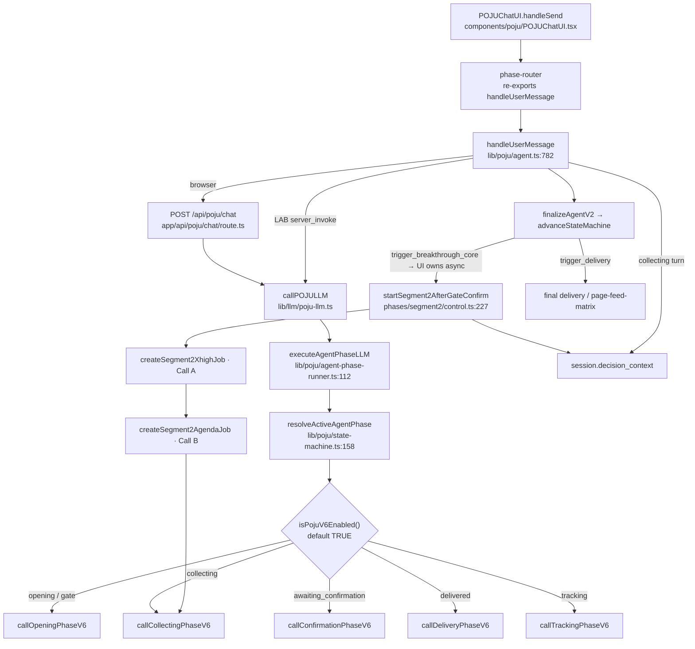
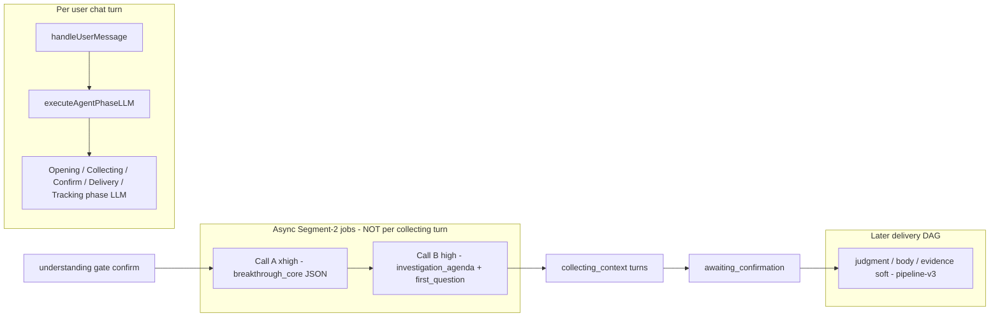
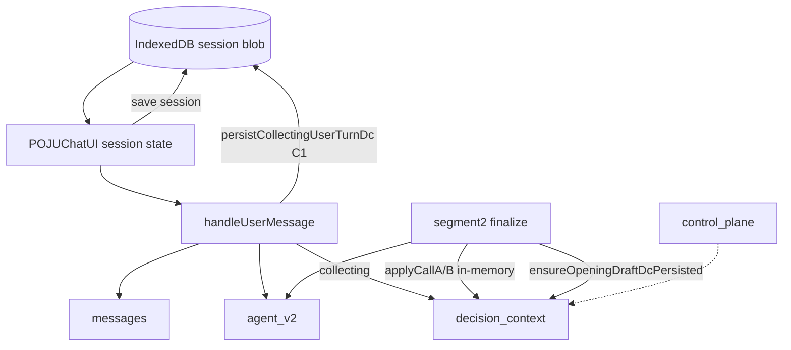
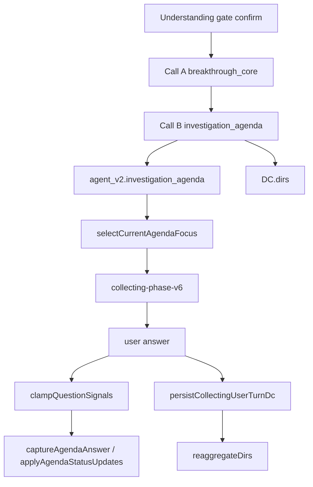
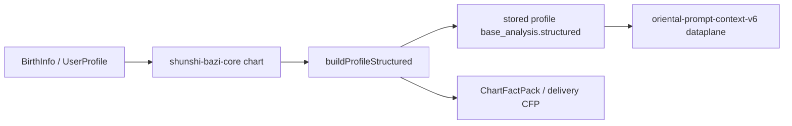
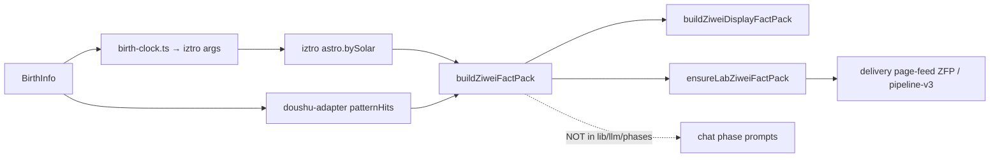
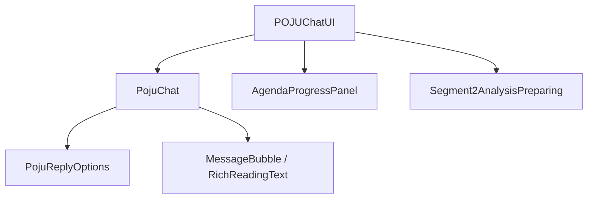

# Decision Intake 2.0 · Phase 0 Codebase Baseline

| Field | Value |
|---|---|
| **Document type** | READ-ONLY codebase audit (no production code changes) |
| **Repository** | `Mattchen217/POJU` (workspace `pojulife`) |
| **Base branch** | `main` |
| **Audit baseline Commit SHA** | `297544134d7dcc8c942d5d314760bc3f4a75423f` |
| **Audit branch** | `docs/decision-intake-2.0-phase-0-baseline` |
| **Date** | 2026-11-04 |
| **Scope** | Agent / DC / Agenda / Prompt / Bazi / Ziwei / Glossary / UI / Report feed |

**Disposition legend**

| Tag | Meaning |
|---|---|
| **REUSE** | Can be reused as-is (pure / stable capability) |
| **ADAPT** | Reuse behind a new adapter; do not call old lifecycle as product entry |
| **REBUILD** | Must rebuild for Intake 2.0 (old stage/Call A/B product flow) |
| **RETIRE** | Not used by Intake 2.0 product flow |
| **VERIFY** | Evidence incomplete; needs follow-up confirmation |

---

## 0. Executive verdict

Current production chat is still a **Stage 1–4 sequential agent** whose spine is:

1. Opening → understanding gate  
2. Segment-2 **Call A** (breakthrough report) → **Call B** (investigation agenda + bridge question)  
3. Collecting → confirmation → delivery / tracking  

Decision Context (DC) exists as a formal data model with strong pure-function tooling, but **production lifecycle wiring is partial**: Opening seed + Collecting facts persist via C1; Call A/B DC apply is mostly **in-memory** (`applyCallAToSessionDc` / `applyCallBToSessionDc`); dedicated `persistCallADcOnSession` / `persistCallBDcOnSession` are **defined but not called** from production paths.

**Intake 2.0 must replace the product entry** (`handleUserMessage` phase spine + Call A/B as agenda factory), while **reusing** local Bazi/Ziwei calc, glossary, DC pure functions, report feed matrix, and much of the chat UI shell.

---

## 1. Audit baseline Commit SHA

```
297544134d7dcc8c942d5d314760bc3f4a75423f
```

Verified on audit start via `git rev-parse HEAD` on `main` (message: `测试修复6`). All path/line citations below refer to this tree unless noted.

---

## 2. Current production architecture



### Product phases (runtime `AgentPhase`)

Source: `lib/poju/agent-state.ts` + `lib/poju/state-machine.ts:32–38`

| Phase | Role today |
|---|---|
| `opening` | Understand dilemma / direction / question |
| `awaiting_understanding_confirm` | Gate confirm → starts Segment-2 |
| `collecting_context` | Ask agenda questions |
| `awaiting_confirmation` | Delivery confirm / stall offer |
| `delivered` | Short post-delivery chat |
| `tracking` | After `main_delivery_done` |

---

## 3. Agent real call chain (Q1–Q10)

### Q1. First user message — which function?

**Client production path**

1. `components/poju/POJUChatUI.tsx` imports `handleUserMessage` from `lib/poju/phase-router.ts:7`  
2. Send path calls `handleUserMessage({ session, userMessage, locale, ... })` (e.g. ~L1279, ~L3309, ~L3951)  
3. `handleUserMessage` — `lib/poju/agent.ts:782`  
4. Loads profile/base_analysis (`loadSessionProfileBundle`) then  
   - browser: `callLLMViaAPI` → `fetch("/api/poju/chat")` (`agent.ts` ~L1545–L1616)  
   - LAB: `server_invoke` → `callPOJULLMDirect` (`agent.ts` ~L959–L970, ~L1471)  
5. API: `app/api/poju/chat/route.ts:19` → `callPOJULLM` → `executeAgentPhaseLLM`

**First LLM entry for a fresh session:** `resolveActiveAgentPhase` returns `"opening"` → `callOpeningPhaseV6` (default).

### Q2. How is Agent Phase decided?

| Layer | Function | Path |
|---|---|---|
| Active LLM phase | `resolveActiveAgentPhase(session)` | `state-machine.ts:158–163` — if `main_delivery_done` → `tracking`; else `agent_v2.current_phase` or `"opening"` |
| Transition after turn | `advanceStateMachine` | `state-machine.ts:286` |
| Legacy / parallel helper | `decidePhaseTransition` / `applyPhaseTransition` | `agent-state.ts:1072+`, `:1205+` |
| Opening → gate | understanding complete + `understanding_sufficient` + ≥2 substantive turns | `agent-state.ts:1078–1097`, `opening-interaction-gate.ts` |

`phase-router.ts` is a **thin re-export barrel**, not a runtime router.

### Q3. Opening — how does it call the model?

```
executeAgentPhaseLLM
  → dispatchPhase("opening")                 # agent-phase-runner.ts:82–99
  → callOpeningPhaseV6(input)                # when isPojuV6Enabled()
  → buildPhaseTransportInputV6               # oriental-prompt-context-v6.ts
  → system = buildPojuSystemPromptV6()       # poju-base-v6 + EASTERN_OS_PERSONA
  → callLLM / OpenRouter via phase transport
```

Rollback: `ENABLE_POJU_V6=false` → `callOpeningPhase` (v5). Flag: `lib/poju/poju-v6-flag.ts:15–18` (**default true**).

### Q4. Call A / Call B — production trigger conditions

| Call | Trigger | Entry | Job |
|---|---|---|---|
| **Call A** | User confirms understanding gate | `startSegment2AfterGateConfirm` `phases/segment2/control.ts:227` | `createSegment2XhighJob` `:126` → xhigh job runner |
| **Call B** | After Call A report success | agenda bridge finalize / `createSegment2AgendaJob` `:645` | Call B maps agenda + `first_question` |

Gate confirm path (`control.ts:236–305`):

1. Phase must be `awaiting_understanding_confirm`  
2. Dyad gate resolved / path locked  
3. `advanceStateMachine` with `confirmation_signal: "confirmed"`  
4. `ensureOpeningDraftDcPersisted` (DC seed)  
5. If `trigger_breakthrough_core` → create Call A job  

**Not** triggered by collecting-phase chat turns. Sync Call A/B inside `handleUserMessage` is explicitly skipped (`agent.ts:1061–1071`).

### Q5. Collecting — how are questions generated?

1. **Agenda factory = Call B** (Segment-2), stored on `agent_v2.investigation_agenda`  
2. Each collecting turn: `callCollectingPhaseV6` builds prompt with agenda + `active_question_state` + state ledger snapshot  
3. Focus selection: `selectCurrentAgendaFocus` / `getNextAgendaFocus` — `investigation-agenda.ts:496+`  
4. Model emits one question (+ options); code clamps cover via `clampQuestionSignals`

### Q6. How are answers parsed and saved?

| Step | Function | Path |
|---|---|---|
| Model signals | `extractModelTurnSignals` | `state-machine.ts:215` |
| Clamp (option pick / 2nd cant-provide) | `clampQuestionSignals` | `question-status.ts:120` |
| Agenda status | `applyAgendaStatusUpdates` / `captureAgendaAnswer` | `investigation-agenda.ts:433`, `:226` |
| Agent merge | `finalizeAgentV2` inside `handleUserMessage` | `agent.ts:1021+` |
| DC fact | `persistCollectingUserTurnDc` | `agent.ts:1349–1357` → `production-dc-lifecycle.ts:407` |
| Session blob | IndexedDB session manager (C1) | `session-manager` + DC persist helpers |

### Q7. LAB-only flows

| Flow | Evidence |
|---|---|
| `server_invoke` on `handleUserMessage` | `agent.ts:142–150`, `:928–970` — ops/LAB in-process LLM, no IndexedDB fetch |
| `lab_prompt_capture` | phase input / Lab call trace |
| Delivery Lab pipeline chat | `lib/llm/pro/delivery/lab/pipeline-chat.ts` imports `handleUserMessage` |
| Lab Ziwei ensure | `lib/ziwei/lab-ziwei.ts` · `ensureLabZiweiFactPack` used heavily in delivery lab |
| `skip_delivery_pipeline` | `HandleInput.server_invoke` · `agent.ts:1367` |

### Q8. Shadow / not fully production-wired

| Item | Status |
|---|---|
| `*-v6` prompt/phase modules | **NOT shadow** — production default via `isPojuV6Enabled()` |
| Comment in `oriental-prompt-context-v6.ts:1–8` saying “影子实现” | **Stale comment** — contradicted by `agent-phase-runner.ts:4–5` and `shared/prompt-prefix.ts` |
| Non-v6 `opening-phase.ts` / `collecting-phase.ts` / `poju-base.ts` | Rollback path when `ENABLE_POJU_V6=false` |
| `persistCallADcOnSession` / `persistCallBDcOnSession` | **Exported but no production call sites** (only `apply*` used in segment2) |
| Opening-anchor / confirmation-event formal modules | Present; full product UX for Fact confirm events is **VERIFY** for chat path |
| Stage4 DC page feed | Wired into delivery/Lab body prompts; production gating via `require-dc-flag` |

### Q9. Entries Intake 2.0 must replace

| Entry | Disposition |
|---|---|
| `handleUserMessage` as product spine | **REBUILD** orchestrator (keep as temporary adapter only) |
| `advanceStateMachine` Stage 1–4 transitions | **REBUILD** |
| Call A/B as agenda factory | **RETIRE** as product entry; calc/report slices may **ADAPT** |
| `awaiting_understanding_confirm` → Segment-2 jump | **RETIRE** |
| Collecting stop via agenda covered / turn caps as sole readiness | **REBUILD** readiness engine |

### Q10. Independently reusable underlying capabilities

| Capability | Path | Tag |
|---|---|---|
| Phase LLM transport plumbing | `phase-transport.ts`, `callLLM` | **ADAPT** |
| Profile / base_analysis load | `session-profile`, stored profiles | **REUSE** |
| Bazi `ProfileStructured` | `build-profile-structured.ts` | **REUSE** |
| Ziwei `buildZiweiFactPack` | `lib/ziwei/fact-pack.ts` | **REUSE** |
| Glossary / autoMark / GlossaryText | `lib/glossary/*`, `term-marking.ts` | **REUSE** |
| DC pure: hash/freeze/DIR aggregate/conflict/normalize | `decision-context/*` | **REUSE** / **ADAPT** |
| Page feed matrix / slice | `page-feed-matrix.ts`, `slice-for-page.ts` | **REUSE** |
| Chat UI shell / MessageBubble / composer options | `POJUChatUI`, `PojuChat`, `PojuReplyOptions` | **ADAPT** |

---

## 4. Model call relationship diagram



**Important:** Collecting questions are **not** Call A/B. Call B only seeds the agenda once (plus regenerate paths).

---

## 5. Session data flow



Authoritative buffers today:

- Chat UX / phase / agenda: **`agent_v2`** (still primary for product UI)  
- Formal facts/hypotheses/dirs: **`decision_context`** (partially synced)  
- Comment in `production-dc-lifecycle.ts:3`: “agent_v2 remains non-authoritative buffer” — aspirational; UI still reads agenda from `agent_v2`

---

## 6. Decision Context data flow

### Q1. Formal create entry

| Function | Path | Role |
|---|---|---|
| `seedDecisionContextFromOpening` | `opening-seed.ts:170` | Pure create from Opening buffers + user statements |
| `seedOpeningDraftDcOnSession` | `production-dc-lifecycle.ts:81` | Session wrapper; skip if draft/final already present |
| `ensureOpeningDraftDcPersisted` | `production-dc-lifecycle.ts:354` | **Production create + C1 persist** — called from `startSegment2AfterGateConfirm` `:284–288` |

### Q2. Fact / Constraint / Hypothesis write entries

| Entity | Write entry | Notes |
|---|---|---|
| Fact (opening) | `seedDecisionContextFromOpening` via user statements | unverified / user_asserted |
| Fact (collecting) | `applyCollectingUserTurnToSessionDc` `:240` → `persistCollectingUserTurnDc` | never auto-confirm |
| Fact confirm | `confirmFact` in `confirmation-event.ts:552` | Confirmation Event path |
| Hypothesis | `applyCallAToSessionDc` / `hypothesesFromBreakthroughCore` | Call A only; never Facts |
| Constraint | types + confirmation helpers | **VERIFY** how often chat writes constraints today |
| DIR | `dirsFromAgenda` / `applyCallBToSessionDc` | Call B agenda → DIR seeds |

### Q3–Q4. DIR generation & aggregation

| Step | Function | Path |
|---|---|---|
| Agenda → DIR | `dirsFromAgenda` | `dir-from-agenda.ts:132` |
| Normalize B | `normalizeCallBInput` | `normalize-call-b.ts` |
| Aggregate | `reaggregateDirs` / `aggregateDirState` | `dir-aggregator.ts:203`, `:85` |
| Fact score | `scoreFactContribution` | `dir-aggregator.ts:60` |

`agendaCoveredImpliesDirKnown()` returns **false** (`dir-from-agenda.ts:148`) — agenda `covered` must not auto-promote DIR to known.

### Q5. Conflict produce / update / confirm

| Action | Function | Path |
|---|---|---|
| Open | `openConflict` | `conflict-lifecycle.ts:37` |
| Clarify (user only) | `clarifyConflict` | `:76` |
| Freeze conversion | `markOpenConflictsUnresolvedInFinal` | used by `freeze.ts:79` |

Preferred-path vs boundary: `conflictAffectsPreferredPath` in `stop-criteria.ts:50`.

### Q6. Freeze real call conditions

`freezeDecisionContext` (`freeze.ts:45`) requires:

- `stage3_sufficiency_end: true`  
- NOT from purchase/CTA  
- NOT from stall / MAX turns  
- `status === "draft"`  
- `evaluateDecisionSufficiency(dc).canStop`  
- Post-aggregation re-check  

Production wire: `ensureSessionFrozenForDelivery` (`production-freeze-wire.ts:177`) — called from segment2/delivery path (`control.ts` ~L1449). Stall/degraded paths blocked (`canFreezeSessionOnSufficiency` `:68–101`).

### Q7. Version / Hash

| Piece | Function | Path |
|---|---|---|
| Content hash | `computeContentHash` → `hashBusinessPayload` | `content-hash.ts:168`, `:163` |
| Freeze stamps hash | `freeze.ts:98` | on final |
| V2 from final | `startV2FromFinal` | `versioning.ts:71` — supersede + version++ |
| Call A/B fingerprints | `fingerprintCallA/B` | `fingerprint.ts:53+` — control_plane fields |

### Q8. Persist idempotency & rollback

`persist.ts`:

- `beginPersistTransaction` — key skip if completed (`:139`)  
- `commitPersistTransaction` — blob write; on failure restore snapshot (`:194–247`)  
- `rollbackToSnapshot` (`:251`)  
- Durable keys on session: `decision_context_idempotency_keys`  

**Gap:** Call A/B dedicated persist helpers unused → A/B DC mutations rely on later session saves without A/B idempotency keys.

### Q9. Lifecycle functions that depend on Call A / Call B

| Function | Dependency |
|---|---|
| `applyCallAToSessionDc` / `persistCallADcOnSession` | breakthrough_core / normalizeCallA |
| `applyCallBToSessionDc` / `persistCallBDcOnSession` | investigation_agenda / normalizeCallB |
| `hypothesesFromBreakthroughCore` | Call A shape |
| `dirsFromAgenda` | Call B agenda shape |
| `fingerprintCallA/B` | Call A/B normalization |

Pure functions that are **shape-bound** but can be adapted: normalize/fingerprint/mappers.

### Q10. Wire Intake 2.0 without copying formal facts

**Recommended:** keep a single `session.decision_context` as SoT; new orchestrator calls:

- `buildRealityFact` / append + `reaggregateDirs`  
- `evaluateDecisionSufficiency` / `freezeDecisionContext`  
- `commitDecisionContextChange` / C1 persist  

Do **not** duplicate facts into a parallel store. Replace Call A/B mappers with Intake 2.0 writers that produce the same `RealityFact` / `Hypothesis` / `DIR` types.

### DC disposition table

| Module | Entry | Deps | Disposition | Action |
|---|---|---|---|---|
| types.ts | type SoT | — | **REUSE** | Keep |
| fact-combination.ts | `buildRealityFact` | types | **REUSE** | Keep |
| dir-aggregator.ts | `reaggregateDirs` | facts/conflicts | **REUSE** | Keep |
| stop-criteria.ts | `evaluateDecisionSufficiency` | dirs/conflicts | **REUSE** | Keep |
| freeze.ts / content-hash / versioning | freeze path | sufficiency | **REUSE** | Keep |
| persist.ts / control-plane | C1 | session | **ADAPT** | New orchestrator commits |
| opening-seed.ts | Opening create | agent buffers | **ADAPT** | New “decision definition” seed |
| hypothesis-from-core.ts | Call A → H | Call A | **ADAPT**/partial **RETIRE** | New hypothesis writer |
| dir-from-agenda.ts | Call B → DIR | Call B | **ADAPT**/partial **RETIRE** | New DIR planner |
| production-dc-lifecycle.ts | Stage lifecycle | Call A/B | **REBUILD** | New lifecycle module |
| normalize-call-a/b.ts | Call A/B normalize | Stage2 JSON | **RETIRE** as entry | Keep only if bridging old jobs |
| dc-page-feed.ts / stage4-report | delivery feed | frozen DC | **REUSE** | Keep |

---

## 7. Agenda / DIR data flow



### Agenda Q1–Q10

| # | Answer | Evidence |
|---|---|---|
| 1 | **Call B** generates agenda | `xhigh-job-runner.ts` Call B mapping; `finalizeSegment2AgendaBridgeSuccess` |
| 2 | **Mostly one-shot** after Call A; regenerate via `startSegment2AgendaRegenerate` / agenda jobs | segment2 control |
| 3 | Each round: `selectCurrentAgendaFocus` + collecting LLM | `investigation-agenda.ts:496`; `collecting-phase-v6.ts` |
| 4 | `status: covered/partial` + `completed_in_this_turn` + `captureAgendaAnswer` | agenda + question-status clamp |
| 5 | `responseReasksCoveredAgendaItem` + pullback / stale catchup blocks | `investigation-agenda.ts:593`, `:479` |
| 6 | Min turns `MIN_COLLECTING_USER_TURNS=3`; max `MAX_COLLECTING_TURNS=12`; stop-loss stall≥2 or resistant; confirm via `canTransitionToConfirmation` | `collection-progress.ts:21–25`; `agent-state.ts:582+`; agenda `:648` |
| 7 | Scope via agenda `supports` / `serves_page` / `frame_kind` + topic drift signals | agenda types; `topic-drift.ts` |
| 8 | Escalation stage 0–4 on `active_question_state`; `unqualified_streak` | `question-status.ts:190`; agenda item fields |
| 9 | Escalation / terminate_refund / wipe timer; composer locks during segment2 | `TERMINATE_REFUND_WIPE_MS`; UI `composerLocked` |
| 10 | **Second cant-provide forces `satisfied`** — marks item complete by design (stop-loss), not accidental | see below |

### `shouldForceSatisfiedAfterSecondCantProvide` — all call sites

| Site | Path | Effect |
|---|---|---|
| Definition | `question-status.ts:36–41` | `looksLikeCantProvideAnswer` && prior cant-provide count ≥ 1 |
| Clamp (authoritative) | `question-status.ts:151–154` | Force `question_status="satisfied"`, clear session_action; may write `completed_in_this_turn` |
| Collecting v6 mirror | `collecting-phase-v6.ts:960–967` | Same force before return payload |
| Unit test | `scripts/test-poju-phase3-cover-alignment.ts:51` | Asserts second cant-provide → true |

**Actual product effect:** On the **same agenda focus**, the second “答不了/无法回答/…” style reply is treated as **covered/satisfied**, advancing agenda. This is intentional hard stop-loss, **not** a full information completion signal. Intake 2.0 readiness must **not** equate this with “direction known.”

---

## 8. Bazi calculation data flow



| # | Answer | Evidence |
|---|---|---|
| 1 | Local Bazi starts from birth → shunshi chart → `buildProfileStructured` | `lib/calculations/build-profile-structured.ts:223` |
| 2 | `ProfileStructured` = day_master, pattern, yong/xi/ji, strength, four_pillars, pillars_detail, da_yun, enrichment, data_availability | same file `:58–83` |
| Persist | `saveBaseAnalysis` / `saveBaseAnalysisFromStream` | `stored-profiles-service.ts` |
| Chat inject | `normalizeBaseAnalysisInput` + profile sections in `oriental-prompt-context-v6.ts` | dataplane; opening phases use **slim** chart (`PHASES_SLIM_CHART_DATAPLANE` `:90–96`) |

**Capability vs integration:** Bazi calc is **production-integrated** into chat + delivery.

---

## 9. Ziwei calculation data flow



| # | Answer | Evidence |
|---|---|---|
| 3 | `buildZiweiFactPack(birth, { asOf })` | `fact-pack.ts:203` |
| 4 | `iztro` + optional `ziwei-doushu` patterns (`ZIWEI_ENGINE`) | `fact-pack.ts:10–20`, `:122–127` |
| 5 | Fields: `topicPalace`, `sihua`, `daxian`, `mingShen`, `otherChart:null`, `patternHits`, `palaces`, `source` | `fact-pack.ts:99–109` |
| 6 | `source.version` (iztro version / patterns commit), `clock`, `asOf`, `solarDate`, `timeIndex` | `ZiweiFactSource` `:83–97` |
| 7 | **Yes in report/Lab delivery** (ZFP allowlists in page-feed-matrix; pipeline-v3 body) | `page-feed-matrix.ts`; `content-body.ts` |
| 8 | **No in chat phase modules** — grep of `lib/llm/phases` finds no ziwei inject | verified |
| 9 | **No unified Personal Analysis Profile** object spanning Bazi+Ziwei for Intake | separate structured + ZFP |
| 10 | Intake 2.0 should read **ProfileStructured** + **ZiweiFactPack** (display projection for prompts) via shared Personal Analysis loader — do not invent second calc | recommendation |

**Capability:** complete. **Chat integration:** incomplete. **Delivery integration:** present (esp. Lab / v3 feeds).

---

## 10. Term replacement data flow

```mermaid
flowchart TD
  Model[Model output - chat: bare traditional OK]
  Auto[autoMarkBareTerms / prepareTextForGlossaryRender]
  Mark[⟦t:slug|plain⟧]
  UI[RichReadingText / GlossaryText / MarkedInline]
  Soft[termOf / resolvePojuTerm SSOT soft label]
  Ev[Delivery evidence soft pipeline]

  Model -->|chat bubble finalize| UI
  UI --> Soft
  Model -->|delivery evidence| Auto --> Mark --> Ev --> UI
```

| # | Answer | Evidence |
|---|---|---|
| 1 | Recognition: closed-set + `autoMarkBareTerms` / compliance scanners | `lib/llm/sanitize/term-marking.ts:1817+`; `compliance-terms.ts` |
| 2 | User-visible replace: Glossary/MarkedInline via `termOf` SSOT | `lib/glossary/pojulife-terms.ts:8452+`; `GlossaryText` |
| 3 | Chat vs delivery: **not identical** — chat phases instruct **no ⟦t:⟧** (backend autoMark / render); delivery evidence uses mark→polish→soft; body layer zero-gold | `poju-base-v6.ts:62`; `evidence-soft.ts` |
| 4 | Ziwei namespace exists (`TermNs = "ziwei"`) and marked active | `term-ns.ts:6–26`; soft labels also in `lib/ziwei/soft-zfp-labels.ts` |
| 5 | Unknown terms: disposition / forbidden registry; ziwei leaks sanitized in prompt helpers | `token-disposition.ts`; `sanitize-prompt-ziwei-leaks.ts` |
| 6 | Intake 2.0: **REUSE** glossary + RichReadingText; do not rebuild dictionaries | hard constraint |

---

## 11. UI component relationships



| # | Answer | Evidence |
|---|---|---|
| 1 | `AgendaProgressPanel` mounted in `POJUChatUI` when `session.agent_v2` present | `POJUChatUI.tsx:4355–4357` |
| 2 | Progress from `agent.investigation_agenda` via `formatAgendaProgressLabel` | `AgendaProgressPanel.tsx:15–27` |
| 3 | Current question = assistant message text; focus also in state ledger / agenda panel labels | messages + panel |
| 4 | Up to 3 chips from last assistant `options`; tap `onPick` sends; pencil `onEdit` fills composer | `PojuReplyOptions.tsx:15–41`; `activeComposerOptions` `POJUChatUI.tsx:3891–3917` |
| 5 | **Personal Pattern Insight (Intake 2.0 sense) does not exist in chat UI** — only report module `personal_decision_patterns` / plans | plans docs; report blueprint |
| 6 | Reuse: `POJUChatUI` shell, composer, `PojuReplyOptions`, `RichReadingText`, message list, attachment hooks | **ADAPT** |
| 7 | Decouple: `agent_v2.current_phase`, segment2 job locks, understanding/delivery gate chips, stall_offer, dyad gate, agenda panel tied to Call B agenda | **REBUILD** state bindings |

---

## 12. Report feed data flow

### Formal 8-page structure (content SoT 2026-10-27)

Source: `page-feed-matrix.ts:11–23` + iron rule / PageFeedMatrix doc

| pageId | Role | Notes |
|---|---|---|
| 01 | Direct answer / brief | main |
| 02 | Foundation / attribution | main |
| 03 | Appendix | package tail |
| 04 | Eastern strategy (P4) | main |
| 05 | Risk guard | main |
| 06 | Signals close | main |
| 07 | Topic-conditional | only if topic applies |
| 08 | Closing face | main |

Main narrative order: `01,02,04,05,06,07,08` (`MAIN_NARRATIVE_PAGE_ORDER`).

Legacy nine-module table still in `report-blueprint.ts` for remap/agenda serves_page — **not** the face-order SoT.

### Per-page feeds (union allowlists)

From `PAGE_UNION_ALLOWLISTS` (`page-feed-matrix.ts:96–153`): each page mixes **User** (Q/expect/detail), **CFP** (Bazi chart fact pack fields), **ZFP** (Ziwei), optional **Sci**.

### Where user info enters

| Source | Use |
|---|---|
| `original_question` / expectation / agenda `captured_answer` | User feed |
| `breakthrough_core` / understanding buffers | Historical Stage2 |
| `decision_context` slice | Stage4 formal feed via `formatDecisionContextSliceForPage` |
| ProfileStructured / ChartFactPack | CFP |
| ZiweiFactPack | ZFP |

### Does DC enter formal report?

**Yes, when Stage4 path / snapshot present** — `dc-page-feed.ts` pages `01,02,04,05,06,08`; consumed in `pipeline-v3/content-body.ts`, Lab `run-step-v3`, book-judgment. Gated by freeze/require flags — not every legacy session.

### DDR → pages (recommendation for Intake 2.0)

| DDR concept (planned) | Map to |
|---|---|
| Decision definition / question / expectation | 01, 02 User.Q/expect |
| Confirmed facts / constraints | 02, 04, 05 detail + DC feed |
| Hypotheses / open risks | 05, 06 |
| Personal pattern (Bazi+Ziwei) | 02/03/04 CFP+ZFP (local calc) |
| Executable means needs | 04, 05, 06 — **needs_reality** collection |

### What Q&A must collect vs local calc

| Needs Q&A (`needs_reality` / User.detail) | Local calc |
|---|---|
| Hard constraints, stakes, options on table, timeline, resources, relationship facts | Bazi structured, DaYun, relations, Ziwei ZFP, pattern hits |
| Validation of hypotheses against real life | Chart-only pages / appendix structure |

`FACE_AGENDA_SERVES_PAGE_IDS` / blueprint `reality_needs` encode which faces historically drove agenda — Intake 2.0 should rebuild this as Decision Blueprint, not Call B serves_page.

---

## 13. Reusable code inventory (summary)

| Area | Paths | Tag |
|---|---|---|
| Bazi structured + relations + shensha | `lib/calculations/**` | **REUSE** |
| Profile storage | `lib/profile/**` | **REUSE** |
| Ziwei fact/display/lab | `lib/ziwei/**` | **REUSE** (chat inject **ADAPT**) |
| Glossary / term marking | `lib/glossary/**`, `lib/llm/sanitize/term-marking.ts` | **REUSE** |
| DC pure math | aggregator, freeze, hash, sufficiency, conflicts, fact-combination | **REUSE** |
| Page feed / slice / schemas | `page-feed-matrix.ts`, `slice-for-page.ts`, page-schema | **REUSE** |
| Eastern OS persona string | `eastern-os-persona.ts` | **REUSE** |
| Chat rendering | `RichReadingText`, `GlossaryText`, `PojuReplyOptions` | **REUSE**/**ADAPT** |
| `callLLM` / OpenRouter | `lib/llm/**` transport | **REUSE** |

---

## 14. Must-rebuild inventory

| Area | Why |
|---|---|
| Decision Intake Orchestrator | Replace `handleUserMessage` stage spine |
| Adaptive Question Engine | Replace Call B one-shot agenda + collecting clamp loop |
| Decision State Engine | Replace `advanceStateMachine` Stage1–4 |
| Decision Readiness Engine | Replace agenda coverage / turn caps as sufficiency proxy; use DC sufficiency for real stop |
| Decision Blueprint (pre-question scope) | Replace post-Call-B agenda as scope source |
| production-dc-lifecycle Call A/B coupling | New writers without Call A/B entry |
| Understanding UI progress model | Replace AgendaProgressPanel data contract |
| Prompt entry for Intake turns | New builder; do not extend Stage prompts as SoT |

---

## 15. Current architecture risks

1. **Dual authority:** UI/agenda still `agent_v2`; formal DC partially synced — Intake 2.0 can fork facts if both keep writing.  
2. **Call A/B DC persist gap:** `persistCallA/BDcOnSession` unused; in-memory apply may be lost or non-idempotent across refresh depending on session save timing.  
3. **Second cant-provide → satisfied** can mark DIR-relevant agenda covered without real information — dangerous if reused as readiness.  
4. **Stale “v6 shadow” comments** risk wrong rollback decisions.  
5. **Ziwei absent from chat prompts** while present in report feeds — Intake personal insight cannot rely on chat model “seeing” Ziwei today.  
6. **Collecting stop ≠ DC sufficiency:** turn/agenda gates (`collection-progress`, `canTransitionToConfirmation`) diverge from `evaluateDecisionSufficiency`.  
7. **Freeze blocked on stall/max-turns** while product may still offer degraded delivery — Intake readiness must keep this distinction explicit.  
8. **Lab vs production paths** (`server_invoke`, Lab ziwei ensure) can hide missing production wiring.

---

## 16. Suggested Intake 2.0 directory structure

```
lib/decision-intake/
  orchestrator/           # session turn entry (replaces handleUserMessage spine)
  blueprint/              # Decision Blueprint SoT (scope before questions)
  state-engine/           # Decision State Engine
  question-engine/        # Adaptive Question Engine
  readiness/              # Decision Readiness Engine → DC sufficiency bridge
  personal-analysis/      # loader: ProfileStructured + ZiweiFactPack (+ display)
  prompts/                # independent prompt builders (do not fork stage v6 as SoT)
  ui-adapters/            # map new state → existing POJUChatUI props

lib/poju/decision-context/   # KEEP — pure DC library (imported, not copied)
lib/glossary/                # KEEP
lib/ziwei/                   # KEEP
lib/calculations/            # KEEP
lib/llm/pro/delivery/        # KEEP report pipeline; consume frozen DC + DDR mapping
```

Docs:

```
docs/eastern-os/decision-intake-2.0/
  PHASE-0-CODEBASE-BASELINE.md          # this file
  PHASE-1-DATA-CONTRACTS.md             # next
  ...
```

---

## 17. Phase 1 data contract suggestions

Define (without implementing here):

1. **`DecisionBlueprint`** — goals, in-scope dirs, out-of-scope, required vs auxiliary info, report face needs.  
2. **`DecisionStateSnapshot`** — understood / need-to-understand / open conflicts / readiness verdict (separate from legacy `AgentPhase`).  
3. **`PersonalAnalysisProfile`** — `{ bazi: ProfileStructured; ziwei: ZiweiFactPack | null; asOf; versions }` read-only projection.  
4. **`QuestionPlan`** — dynamic next question + purpose + dir_id + depth budget (not a static 30-question list).  
5. **DC write API** — only append Facts/Constraints/Hypotheses/Conflicts via typed commands; freeze only via sufficiency.  
6. **UI projection** — `UnderstandingPanelModel` replacing agenda-covered UX; optional Pattern Insight DTO.  
7. **Report binding** — DDR/frozen DC → `formatDecisionContextSliceForPage` + existing CFP/ZFP allowlists.

Reuse existing TypeScript types from `decision-context/types.ts` wherever possible to avoid parallel fact models.

---

## 18. Unconfirmed items (VERIFY)

| Item | Why unverified |
|---|---|
| Whether every production session save after Call A/B finalize reliably persists in-memory DC | Need runtime/session-manager trace beyond static call graph |
| How often `confirmFact` / Opening Anchor confirm run in live chat UX | Modules exist; chat UX wiring depth not fully traced end-to-end |
| Constraint write frequency in collecting | Types + helpers exist; production writers sparse in grep |
| Exact production `REQUIRE_DECISION_CONTEXT` / freeze flag defaults on Vercel | Env-dependent (`require-dc-flag.ts`) |
| Whether any chat prompt path injects Ziwei via non-`phases/` side door | No hits under `lib/llm/phases`; other paths **VERIFY** |
| Full list of Segment-2 silent retry ceilings vs product SLA | Constants in segment2 control; ops behavior **VERIFY** |
| Personal Pattern Insight copy/UI experiments outside main chat | Not found in components; may exist only in plans |

---

## Appendix A — Module disposition master table

| Module | Current entry | Current deps | Disposition | Handling |
|---|---|---|---|---|
| `phase-router` / `handleUserMessage` | UI send | phases, SM, LLM API | **REBUILD** | New orchestrator; temporary façade OK |
| `agent-phase-runner` | `executeAgentPhaseLLM` | v6 phases | **ADAPT** | May host new phase modules later |
| `state-machine` | `advanceStateMachine` | agenda, gates | **REBUILD** | New state engine |
| `agent-state` | buffers / gates | session | **ADAPT** | Keep types during migration |
| Opening/Collecting v6 phases | chat turns | prompts, agenda | **RETIRE** as SoT | Replace Intake prompts |
| Segment2 Call A/B | gate confirm | xhigh jobs | **RETIRE** as Intake entry | Optional offline analysis job |
| `investigation-agenda` | Call B + collecting | report blueprint | **ADAPT** | Pure helpers reuse; generation rebuild |
| `question-status` / collection-progress | clamp / stop-loss | collecting | **ADAPT** | Depth controls; not readiness SoT |
| `production-dc-lifecycle` | Stage seed/A/B/collect | Call A/B | **REBUILD** | New lifecycle |
| DC pure libs | freeze/hash/DIR/… | types | **REUSE** | Import |
| `oriental-prompt-context-v6` | chat system/user | persona, bazi | **ADAPT** | Extract persona/dataplane; new entry |
| `eastern-os-persona` | identity | — | **REUSE** | Keep |
| Bazi calculations | profile build | shunshi | **REUSE** | Keep |
| Ziwei fact-pack | buildZiweiFactPack | iztro | **REUSE** | Add chat loader |
| Glossary | termOf / autoMark | — | **REUSE** | Do not rebuild |
| `POJUChatUI` / `PojuChat` | product UI | agent_v2 | **ADAPT** | Decouple phase |
| `AgendaProgressPanel` | collecting UX | agenda | **ADAPT**/**REBUILD** model | New understanding panel |
| `page-feed-matrix` / delivery v3 | report | CFP/ZFP/User/DC | **REUSE** | Map DDR → feeds |
| Delivery Lab | ops | handleUserMessage | **VERIFY**/isolate | Not Intake product path |

---

## Appendix B — Prompt effective path (section 4 of task)

| # | Answer |
|---|---|
| 1 | Production default builders: **v6** — `buildPojuSystemPromptV6` / `buildPhaseTransportInputV6` via `call*PhaseV6` |
| 2 | Persona: `EASTERN_OS_PERSONA` → `POJU_IDENTITY_V6` in `poju-base-v6.ts:26–33` |
| 3 | Bazi: `base_analysis` / `ProfileStructured` in oriental-prompt-context-v6 dataplane (+ slim vs full by phase) |
| 4 | Ziwei: **not injected in chat phases** today |
| 5 | Term rules: chat = no ⟦t:⟧ instruction + backend autoMark; closed-set blocks via `buildChatPhaseTermBindingBlock` / term-context-for-facts; delivery has separate mark pipeline |
| 6 | Files named v6 are **production**, not shadow (stale header comment) |
| 7 | New system: `lib/decision-intake/prompts/*` independent entry; import persona + dataplane helpers; never make Stage collecting rules the SoT |

---

## Appendix C — Files touched by this Phase 0 delivery

- `docs/eastern-os/decision-intake-2.0/PHASE-0-CODEBASE-BASELINE.md` (**only**)

No production code, prompts, schemas, env, or UI modified.

---

## Appendix D — Stop point

Phase 0 complete. **Do not start Phase 1** until architecture reviewers PASS this document against GitHub commit contents.
