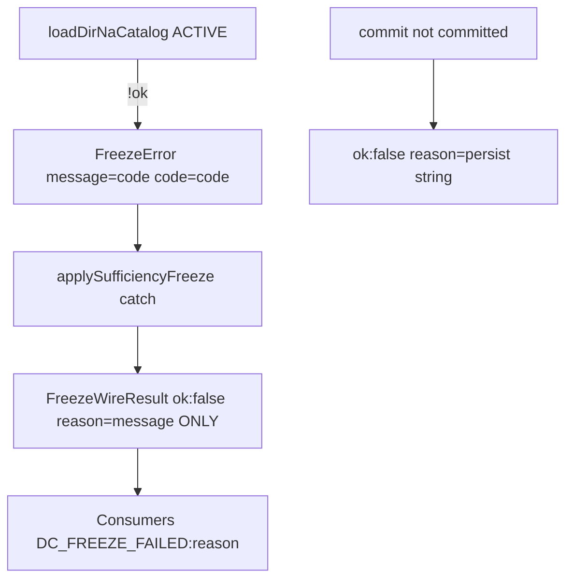
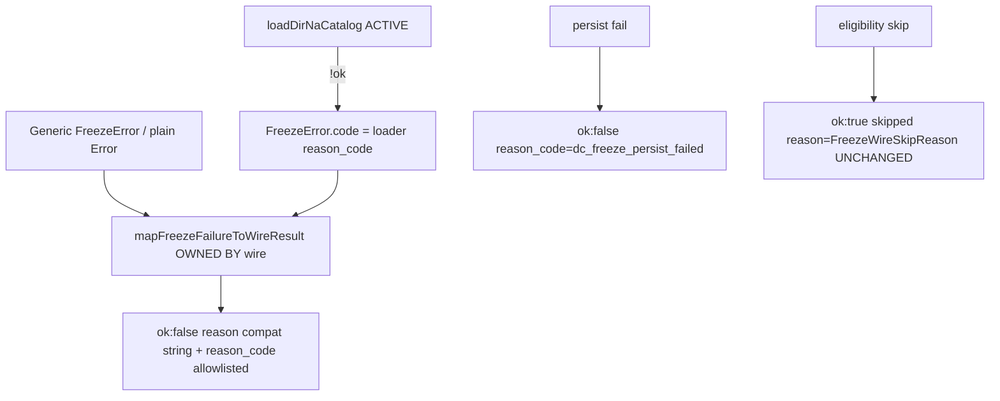

# STAGE-3.2 S3 Implementation Plan

**S3 Implementation Plan — Plan Only — Not Authorized for Implementation**

| Field | Value |
|---|---|
| **Document status** | PLAN ONLY — no production/test implementation authorized by this document |
| **Authoritative design** | [`STAGE-3.2-DIR-CATALOG-VERTICAL-SLICE-DESIGN.md`](./STAGE-3.2-DIR-CATALOG-VERTICAL-SLICE-DESIGN.md) **Revision 1.3** §5.2, §7 (DC-4/5/6 wire), §10.1, §10.3 **S3 row** |
| **S2 accepted baseline** | `9411c83f475605945874f87bb969db3ac1329ee9` |
| **S2 parent** | `7eda9bd44791562c0f4c151231df898fe6319c6a` |
| **Proposed implement branch** | `feat/s3-freeze-wire-reason-code` (from S2 tip above) |
| **S3 implement** | **NOT AUTHORIZED** until independent plan review PASS + separate written implement auth |

---

## 1. Objective

Wire-level structured failure reporting for Freeze:

- Preserve S2 `FreezeError.code` (internal).
- Map allowlisted internal codes onto `FreezeWireResult` **`reason_code`** when `ok: false`.
- Keep skip paths and persistence failures distinguishable.
- Do **not** treat arbitrary `Error.message` as a public machine code.

S3 builds **only** on accepted S2. No Catalog/loader/S2 compose changes in this phase.

---

## 2. Production call-chain audit (inspected @ S2 tip)

### 2.1 End-to-end path (catalog load fail)

```
loadDirNaCatalog(ACTIVE)                         // catalog/load-dir-na-catalog.ts
  → !ok { reason_code }
buildFreezeNaValidationFromSession               // freeze-to-delivery.ts ~L152–154
  → throw new FreezeError(reason_code, { code: reason_code })   // S2 — .code set
freezeDraftForDelivery
  → buildFreezeNaValidationFromSession → freezeDecisionContext
applySufficiencyFreezeToSession                  // production-freeze-wire.ts ~L144–172
  → try { freezeDraftForDelivery(...) }
  → catch (e) {
        return { ok: false, reason: e.message, session }   // ★ STRUCTURE LOST
      }
ensureSessionFrozenForDelivery                   // ~L180–250
  → applySufficiencyFreezeToSession(...)
  → if !ok return applied                          // propagates string-only failure
  → else persist via commitDecisionContextChange
  → if !commit.committed → { ok:false, reason: commit.error ?? "dc_freeze_persist_failed" }
```

### 2.2 Where structured information is lost today

| Site | Behavior | Loss |
|---|---|---|
| `applySufficiencyFreezeToSession` catch L167–172 | `reason: e instanceof Error ? e.message : String(e)` | **`FreezeError.code` discarded**; only message kept |
| `FreezeWireResult` `ok: false` | `{ reason: string }` only | No `reason_code` field |
| Snapshot / bind failures in `assertSessionDraftBusinessSnapshotBound` | throw plain `Error` with prose message | Caught same catch → message becomes Wire `reason` |
| Generic `FreezeError` (CTA/stall/sufficiency/…) | usually **no** `.code` | Wire cannot classify vs catalog |
| `ensureSessionFrozenForDelivery` persist fail L239–243 | `reason: commit.error ?? "dc_freeze_persist_failed"` | No structured `reason_code`; luckily default string is already a token |

### 2.3 Production consumers of `FreezeWireResult`

| Consumer | Path | Failure handling |
|---|---|---|
| Final delivery | `lib/llm/pro/final-delivery.ts` ~L931–941 | `if (!freeze.ok) throw new Error(\`DC_FREEZE_FAILED:${freeze.reason}\`)` |
| Segment2 control | `lib/poju/phases/segment2/control.ts` ~L1452–1473 | Same pattern when draft sufficient |
| Lab pipeline | `lib/llm/pro/delivery/lab/pipeline-jobs.ts` ~L1184–1215 | Same; uses `applySufficiencyFreezeToSession` (in-memory) |
| Lab / scripts | `scripts/s8-freeze-and-thesis.ts`, `test-s5-freeze-s6-observation.ts` | Read `ok` / skip / pack |

**API / delivery boundary:** No dedicated HTTP `FreezeWireResult` DTO found. Failures surface as thrown `Error` with prefix `DC_FREEZE_FAILED:` + **`freeze.reason` string**. Clients that parse after the colon today see **messages**, not a closed code set.

**Skip path (`ok: true, skipped: true`)** uses `reason: FreezeWireSkipReason` — **unchanged by S3**; do not conflate with `ok: false` `reason_code`.

### 2.4 S2 already provides (do not redo)

- `FreezeError` ctor with optional `{ code?: string }`.
- Catalog load fail throws `FreezeError(reason_code, { code: reason_code })`.
- ACTIVE load + ignore `authority.dirCatalog`.
- `!load.ok → FreezeError.code` remains **code-reviewed, not runtime-tested** (S2). S3 does **not** add Registry injection to runtime-test that branch.

---

## 3. Current vs proposed error flow

### 3.1 Current (S2)



### 3.2 Proposed (S3)



---

## 4. Design decisions (locked for this plan)

### 4.1 Internal `FreezeError.code` vs Wire `reason_code`

| Layer | Field | Role |
|---|---|---|
| Internal | `FreezeError.code?: string` | Set by throw sites (catalog already); **not** a public API contract by itself |
| Wire | `FreezeWireResult` `ok: false` → **`reason_code: string`** (required on fail branch) | Closed / allowlisted machine token for callers |
| Wire | `reason: string` | **Backward-compatible** human/legacy string (may equal `reason_code` for catalog; may remain prose for generic freeze) |

**Ownership:** Mapping lives **only** in `production-freeze-wire.ts` (pure helper + catch / persist sites). Compose/S2 does not build `FreezeWireResult`.

### 4.2 Mapping boundary

```ts
// Pseudocode — plan only
function mapCaughtFreezeFailure(e: unknown): {
  reason: string;
  reason_code: string;
}
```

Used by `applySufficiencyFreezeToSession` catch. Persist failure sets codes **without** going through this catch.

### 4.3 Allowlisted internal codes → Wire `reason_code` (1:1)

**Catalog / loader (map when `e instanceof FreezeError` && `e.code` in set):**

| Internal `FreezeError.code` | Wire `reason_code` | S3 claim |
|---|---|---|
| `dir_catalog_ssot_unavailable` | `dir_catalog_ssot_unavailable` | DC-4 wire mapping |
| `dir_catalog_load_failed` | `dir_catalog_load_failed` | DC-5 |
| `dir_catalog_version_unknown` | `dir_catalog_version_unknown` | DC-6 (distinct; loader-level — wire must still map if thrown) |
| `dir_catalog_version_missing` | `dir_catalog_version_missing` | DC-4-missing (loader-only; map if present; **not** claimed as everyday Freeze ACTIVE path) |
| `dir_catalog_version_invalid` | `dir_catalog_version_invalid` | Loader-only; map if present |

**Persist (not from FreezeError):**

| Source | Wire `reason_code` |
|---|---|
| `!commit.committed` | `dc_freeze_persist_failed` |
| Prefer stable token even if `commit.error` prose exists | `reason` may carry `commit.error` for debug; **`reason_code` stays `dc_freeze_persist_failed`** |

### 4.4 Unknown or absent internal code

| Case | `reason_code` | `reason` |
|---|---|---|
| `FreezeError` with **no** `.code` | `freeze_failed` | Keep `e.message` (compat for `DC_FREEZE_FAILED:${reason}`) |
| `FreezeError` with `.code` **not** in allowlist | `freeze_failed` | Keep message; **do not** pass unknown code through as public `reason_code` |
| Non-`FreezeError` `Error` (e.g. snapshot mismatch) | `freeze_failed` | Keep `e.message` |
| Non-Error throw | `freeze_failed` | `String(e)` |

**Forbidden:** `reason_code = e.message`; exposing arbitrary internal strings as codes.

### 4.5 Generic Freeze vs catalog vs persistence

| Class | How distinguished |
|---|---|
| Catalog loader | `reason_code` ∈ `dir_catalog_*` allowlist |
| Generic Freeze / bind / sufficiency | `reason_code === "freeze_failed"` |
| Persistence | `reason_code === "dc_freeze_persist_failed"` |
| Eligibility skip | Still `ok: true, skipped: true, reason: FreezeWireSkipReason` — **not** `ok: false` |

### 4.6 Persistence vs Freeze validation

`ensureSessionFrozenForDelivery`:

1. If `applySufficiencyFreezeToSession` returns `ok: false` → return as-is (**already has `reason_code`** after S3).
2. If persist fails → **separate** branch: `reason_code: "dc_freeze_persist_failed"`; never reuse catalog codes; never parse `commit.error` into `reason_code`.

### 4.7 Backward compatibility

| Consumer expectation | S3 rule |
|---|---|
| `freeze.ok` / `freeze.skipped` | Unchanged |
| `freeze.reason` on fail | **Remain present**; for catalog failures set `reason === reason_code` (stable token, same as today’s message for S2 catalog throws) |
| `DC_FREEZE_FAILED:${freeze.reason}` | Continues to work; catalog cases get token after colon instead of prose |
| Skip `reason` union | Unchanged |
| New field | Add **`reason_code: string`** on `ok: false` only (required) |

**API response contracts:** No separate Freeze DTO in HTTP layer found. **Out of S3:** changing `DC_FREEZE_FAILED` prefix or adding a new HTTP error body. Optional follow-up (separate auth): consumers prefer `freeze.reason_code` when present — document as recommended, not required in S3 Diff.

### 4.8 Explicit non-assumptions

- Not every `Error.message` is a stable code.
- S3 does **not** claim runtime fault-injection of S2 `!load.ok` inside production loader.
- S3 does **not** claim wire `reason_code` ≡ “catalog load was runtime-faulted in CI.”

---

## 5. Exact files and functions to change

### 5.1 Production allowlist

| Path | Change |
|---|---|
| [`lib/poju/decision-context/production-freeze-wire.ts`](../../../lib/poju/decision-context/production-freeze-wire.ts) | Extend `FreezeWireResult` `ok: false` with `reason_code: string`; add pure `mapCaughtFreezeFailure`; update `applySufficiencyFreezeToSession` catch; update `ensureSessionFrozenForDelivery` persist-fail return |

### 5.2 Production denylist (S3)

- `freeze.ts` / `freeze-to-delivery.ts` / `catalog/**` / `na-declaration.ts` (except if a type-only import of reason union is needed — prefer defining Wire allowlist in wire file)
- Sufficiency Gate, Schema, C5, Versioning, CFP/Topic, S4/S5 work
- Consumer files (`final-delivery.ts`, `segment2/control.ts`, lab) — **no required change** for S3 (compat via `reason`); optional later

### 5.3 Tests allowlist

| Path | Role |
|---|---|
| `scripts/test-intake-r6-dir-catalog.ts` **or** new `scripts/test-intake-r6-freeze-wire-reason.ts` | Pure mapper + wire catch path tests |
| `package.json` | Only if new script |

Prefer **new focused script** to avoid overloading dir-catalog; either is acceptable if plan allowlist is followed.

---

## 6. Test matrix

### 6.1 Pure mapping (`mapCaughtFreezeFailure`) — primary S3 coverage

| Case | Input | Expected `reason_code` | Expected `reason` |
|---|---|---|---|
| Each allowlisted catalog code | `FreezeError(code, { code })` | same code | same code (or message===code) |
| Unknown code | `FreezeError("x", { code: "not_in_allowlist" })` | `freeze_failed` | message preserved |
| Missing code | `FreezeError("Decision not sufficient…")` | `freeze_failed` | message preserved |
| Plain `Error` | `new Error("freezeDraftForDelivery: …")` | `freeze_failed` | message preserved |
| Non-Error | `"boom"` | `freeze_failed` | `"boom"` |

**Label:** pure Wire mapping coverage — **not** production Registry failure integration; **not** S2 load-branch runtime coverage.

### 6.2 Wire integration (no Registry injection)

| Case | Method | Setup | Assert |
|---|---|---|---|
| Catch path uses mapper | `applySufficiencyFreezeToSession` | Stub/spy **not** required if mapper is unit-tested and catch is one-liner calling mapper — **or** throw a synthetic `FreezeError` by temporarily wrapping `freezeDraftForDelivery` **only in test** via dependency injection **forbidden** → prefer: export pure mapper; catch body trivial; optionally test catch by importing mapper. **Do not** add production Registry seams. |
| Skip unchanged | eligibility fail | `ok: true, skipped, reason ∈ FreezeWireSkipReason`; **no** `reason_code` on skip |
| Persist distinct | `ensureSessionFrozenForDelivery` | Mock/`casWrite` fail if existing test harness allows; else pure assert of persist-fail object shape in a small extracted helper `persistFailResult(session, commitError)` | `reason_code === "dc_freeze_persist_failed"` ≠ any `dir_catalog_*` |
| Both entrypoints | Document that `ensureSessionFrozenForDelivery` returns apply failure unchanged | When apply returns catalog-mapped fail, ensure path returns same `reason_code` | |

Practical locked approach:

1. **Pure** `mapCaughtFreezeFailure` tests = required.
2. **`applySufficiencyFreezeToSession` catch** implemented as thin wrapper around mapper (code review + optional smoke if a test can throw FreezeError without Registry — e.g. invalid session snapshot causing plain Error → `freeze_failed`).
3. **Persist** path: extract one-liner builder or assert in unit test of returned object literals.

### 6.3 Compatibility / regression

| Suite | Expectation |
|---|---|
| `pnpm test:intake-r6-dir-catalog` | PASS (S0–S2) |
| `pnpm test:intake-r6-na-cas` / `resolver` | PASS |
| `pnpm exec tsc --noEmit` | PASS |
| `pnpm test:intake-r6-freeze-versioning` | Still known staged RED at F1 until S5 — disclose, do not “fix” |

### 6.4 Explicitly out of S3 test claims

- Runtime inducing `dir_catalog_ssot_unavailable` / `load_failed` via production Registry.
- S2 compose `!load.ok` runtime coverage.
- S4 DC-10 / S5 F1–F4.

---

## 7. Compatibility analysis

| Area | Impact |
|---|---|
| TypeScript consumers of `FreezeWireResult` | Must handle new required `reason_code` on `ok: false` — update any exhaustive switches; runtime callers using only `.reason` keep working |
| `DC_FREEZE_FAILED:${freeze.reason}` | Compatible; catalog failures become token-shaped reasons |
| Skip union | Unchanged |
| S2 compose | Unchanged |
| Persist failure | Gains explicit `reason_code`; `reason` may still show commit error text |

---

## 8. Non-goals and phase boundaries

| Non-goal | Owner |
|---|---|
| Catalog SSOT / loader / S2 ACTIVE isolation | Frozen |
| Sufficiency Gate / CTA / stall rules | Frozen |
| Schema / C5 / Versioning / CFP / Topic | Out |
| S4 DC-10 | Next |
| S5 F1–F4 fixture migration | Later mandatory |
| Changing HTTP error envelope beyond Wire type | Out unless separately authorized |
| Equating S3 with “catalog load runtime-faulted in CI” | Forbidden |

---

## 9. Acceptance criteria

S3 may be accepted only when:

1. `FreezeWireResult` `ok: false` includes **`reason_code: string`**.
2. Catch path maps allowlisted `FreezeError.code` → same `reason_code`; unknown/absent → `freeze_failed`; **never** message-as-code.
3. Persist failure uses `reason_code: "dc_freeze_persist_failed"` distinct from catalog codes.
4. Skip reasons unchanged.
5. Pure mapping tests cover §6.1; reports label **pure Wire mapping**, not Registry integration / not S2 load runtime.
6. Production Diff ⊆ §5.1; baseline parent = `9411c83f475605945874f87bb969db3ac1329ee9`.
7. Required green suites in §6.3 pass; freeze-versioning disclosed as staged RED.
8. **Not claimed:** S4/S5; wire reason_code ≡ runtime loader injection; API redesign of `DC_FREEZE_FAILED`.

---

## 10. Verification commands (when implement authorized)

```bash
pnpm test:intake-r6-dir-catalog
pnpm test:intake-r6-na-cas
pnpm test:intake-r6-resolver
pnpm exec tsc --noEmit
# plus new wire-mapping script if added
pnpm test:intake-r6-freeze-versioning   # disclose RED / S5 dependency
```

---

## Stop Condition

This document is **plan-only**.

No production or test implementation is authorized hereby.  
Do not start S4/S5.  
Wait for independent plan review and **explicit written S3 implementation authorization**.

**PLAN ONLY — NOT AUTHORIZED FOR IMPLEMENTATION**
