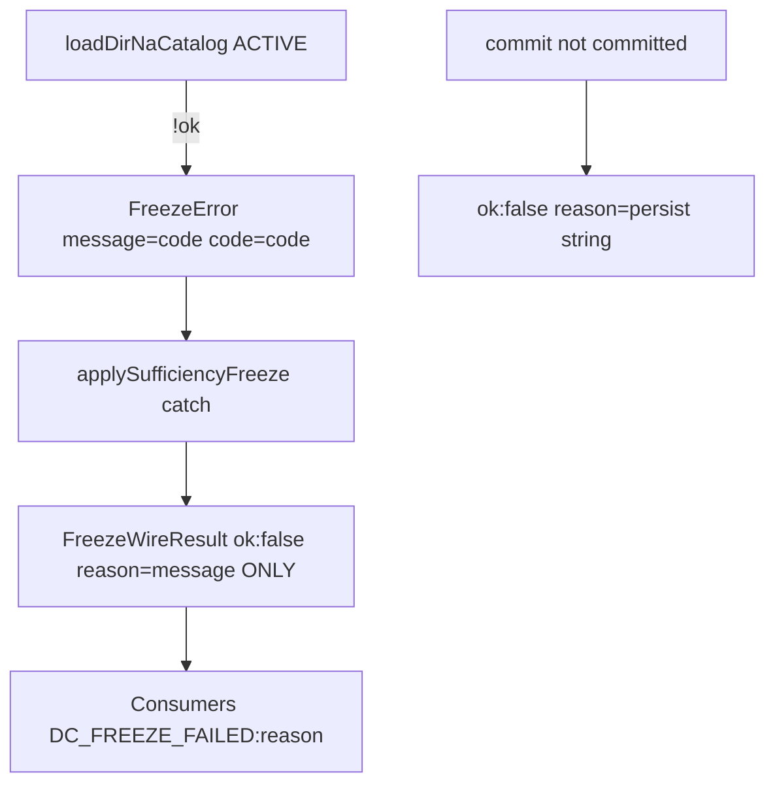
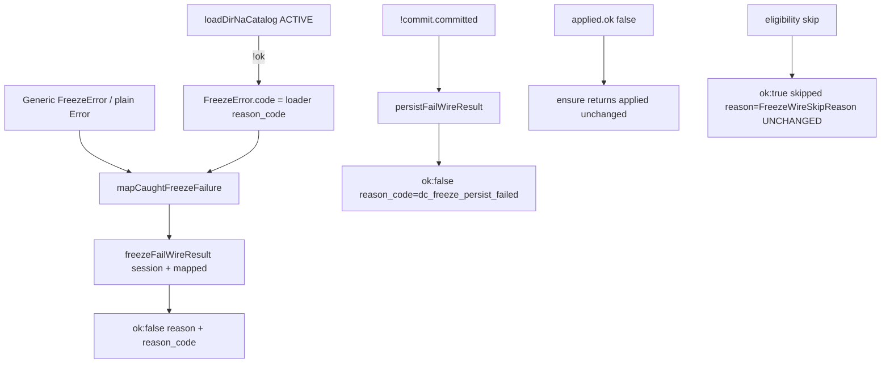

# STAGE-3.2 S3 Implementation Plan

**S3 Implementation Plan — Plan Only — Not Authorized for Implementation**

| Field | Value |
|---|---|
| **Document status** | PLAN ONLY — no production/test implementation authorized by this document |
| **Revision** | **1.1** (resolves plan review R1–R4 against `ce520987`) |
| **Rev 1.0 plan commit** | `ce520987e928cc7fc7ea10313db8666f90661828` |
| **Authoritative design** | [`STAGE-3.2-DIR-CATALOG-VERTICAL-SLICE-DESIGN.md`](./STAGE-3.2-DIR-CATALOG-VERTICAL-SLICE-DESIGN.md) **Revision 1.3** §5.2, §7 (DC-4/5/6 wire), §10.1, §10.3 **S3 row** |
| **S2 accepted baseline** | `9411c83f475605945874f87bb969db3ac1329ee9` |
| **S2 parent** | `7eda9bd44791562c0f4c151231df898fe6319c6a` |
| **Proposed implement branch** | `feat/s3-freeze-wire-reason-code` (from S2 tip above) |
| **S3 implement** | **NOT AUTHORIZED** until independent plan review PASS + separate written implement auth |

### Revision 1.1 — review resolutions

| Review | Resolution (locked below) |
|---|---|
| **R1** catch-path test strategy | §6.2 Tier B — export thin `freezeFailWireResult(session, e)`; unit-test with **constructed** `FreezeError` / plain `Error` (not Registry); catch body must only call that helper (code-review gate) |
| **R2** persist + propagation | §6.2 Tier B — export `persistFailWireResult(session, commitError?)`; unit-test shape; propagation = `ensure` returns apply fail unchanged + optional ensure-driven plain-Error fail |
| **R3** consumer/type audit | §2.3 + §7 — complete inventory; no consumer Diff required in S3 |
| **R4** evidence separation | §6.0 — Tier A unit / Tier B production-path / Tier C regression labeled distinctly |

---

## 1. Objective

Wire-level structured failure reporting for Freeze:

- Preserve S2 `FreezeError.code` (internal).
- Map allowlisted internal codes onto `FreezeWireResult` **`reason_code`** when `ok: false`.
- Keep skip paths and persistence failures distinguishable.
- Do **not** treat arbitrary `Error.message` as a public machine code.

S3 builds **only** on accepted S2. No Catalog/loader/S2 compose changes in this phase.

---

## 2. Production call-chain audit (inspected @ S2 tip)

### 2.1 End-to-end path (catalog load fail)

```
loadDirNaCatalog(ACTIVE)                         // catalog/load-dir-na-catalog.ts
  → !ok { reason_code }
buildFreezeNaValidationFromSession               // freeze-to-delivery.ts ~L152–154
  → throw new FreezeError(reason_code, { code: reason_code })   // S2 — .code set
freezeDraftForDelivery
  → buildFreezeNaValidationFromSession → freezeDecisionContext
applySufficiencyFreezeToSession                  // production-freeze-wire.ts ~L144–172
  → try { freezeDraftForDelivery(...) }
  → catch (e) {
        return { ok: false, reason: e.message, session }   // ★ STRUCTURE LOST
      }
ensureSessionFrozenForDelivery                   // ~L180–250
  → applySufficiencyFreezeToSession(...)
  → if !ok return applied                          // propagates string-only failure
  → else persist via commitDecisionContextChange
  → if !commit.committed → { ok:false, reason: commit.error ?? "dc_freeze_persist_failed" }
```

### 2.2 Where structured information is lost today

| Site | Behavior | Loss |
|---|---|---|
| `applySufficiencyFreezeToSession` catch L167–172 | `reason: e instanceof Error ? e.message : String(e)` | **`FreezeError.code` discarded**; only message kept |
| `FreezeWireResult` `ok: false` | `{ reason: string }` only | No `reason_code` field |
| Snapshot / bind failures in `assertSessionDraftBusinessSnapshotBound` | throw plain `Error` with prose message | Caught same catch → message becomes Wire `reason` |
| Generic `FreezeError` (CTA/stall/sufficiency/…) | usually **no** `.code` | Wire cannot classify vs catalog |
| `ensureSessionFrozenForDelivery` persist fail L239–243 | `reason: commit.error ?? "dc_freeze_persist_failed"` | No structured `reason_code`; luckily default string is already a token |

### 2.3 Complete `FreezeWireResult` consumer / type audit (R3)

**Type definition (sole constructor site today):**  
`lib/poju/decision-context/production-freeze-wire.ts` — `FreezeWireResult` discriminated union; `ok: false` = `{ reason: string; session }` only.  
**Re-export:** `lib/poju/decision-context/index.ts` → `export * from "./production-freeze-wire"`.

**No other production file constructs `ok: false` FreezeWireResult literals.** Only the two functions below return that branch.

#### 2.3.1 Producers (must gain `reason_code`)

| Function | Fail branches | S3 change |
|---|---|---|
| `applySufficiencyFreezeToSession` | catch → `{ ok:false, reason, session }` | Via `freezeFailWireResult` |
| `ensureSessionFrozenForDelivery` | (a) return `applied` when `!applied.ok`; (b) persist `!commit.committed` | (a) pass-through; (b) via `persistFailWireResult` |

#### 2.3.2 Runtime / product consumers

| File | Call site | Fields read | Narrowing | Reads `reason` on fail? | Uses `reason_code` today? | S3 Diff required? |
|---|---|---|---|---|---|---|
| `lib/llm/pro/final-delivery.ts` ~L931–941 | `ensureSessionFrozenForDelivery` | `ok`, `reason`, `session` | `if (!freeze.ok)` | Yes — `DC_FREEZE_FAILED:${freeze.reason}` | No | **No** — keeps `.reason` |
| `lib/poju/phases/segment2/control.ts` ~L1452–1473 | `ensureSessionFrozenForDelivery` | `ok`, `reason`, `session` | `freeze.ok` then `!freeze.ok && draft` | Yes — same throw | No | **No** |
| `lib/llm/pro/delivery/lab/pipeline-jobs.ts` ~L1184–1215 | `applySufficiencyFreezeToSession` | `ok`, `skipped`, `pack`, `binding`, `reason`, `session` | `freeze.ok` / `else if draft` | Yes — same throw | No | **No** |

**HTTP / API:** None of the above serialize `FreezeWireResult` as JSON response. Failures become thrown `Error` with prefix `DC_FREEZE_FAILED:` + **`freeze.reason`**. No API DTO contract change in S3.

#### 2.3.3 Scripts / harness consumers

| File | Call site | Fields read | S3 Diff required? |
|---|---|---|---|
| `scripts/s8-freeze-and-thesis.ts` ~L78–84 | `applySufficiencyFreezeToSession` | `ok`, `skipped`, `reason` (log only) | **No** — logging gains optional new field in JSON dumps if stringify full object elsewhere; current log does not require `reason_code` |
| `scripts/test-s5-freeze-s6-observation.ts` ~L158–188 | `applySufficiencyFreezeToSession` | Asserts `ok: true` success / skip only | **No** — never asserts fail branch |
| `scripts/test-intake-r6-freeze-versioning.ts` ~L659+, ~L997 | `ensureSessionFrozenForDelivery` / `applySufficiencyFreezeToSession` | Expects success or skip; `JSON.stringify(freeze)` on unexpected fail | **No** required for S3 green path; stringify will include `reason_code` after S3 (harmless). Suite remains staged RED at F1 until S5 (disclose, not “fix”) |

#### 2.3.4 TypeScript compatibility verdict

| Concern | Verdict |
|---|---|
| Adding **required** `reason_code: string` on `ok: false` | Breaks **only** sites that construct that variant → both are inside `production-freeze-wire.ts` (S3 Diff). |
| Consumers that only read `.reason` after `!ok` | Compile + runtime OK. |
| Skip arm `reason: FreezeWireSkipReason` | Unrelated field; **must not** add `reason_code` on `ok: true`. |
| Exhaustive switches on skip `reason` | Unaffected. |
| Discriminated access `freeze.reason` when `ok` | TypeScript already requires narrowing (`ok && skipped` vs `!ok`); S3 must keep fail `reason` so existing access remains typed. |
| Barrel re-export | Automatic; no index change needed unless implement chooses not to export helpers (helpers **should** be exported for Tier A/B tests — §5.1). |
| Downstream optional adoption of `reason_code` | **Out of S3 Diff**; recommended later for consumers that throw `DC_FREEZE_FAILED`. |

**Skip path (`ok: true, skipped: true`)** uses `reason: FreezeWireSkipReason` — **unchanged by S3**; do not conflate with `ok: false` `reason_code`.

### 2.4 S2 already provides (do not redo)

- `FreezeError` ctor with optional `{ code?: string }`.
- Catalog load fail throws `FreezeError(reason_code, { code: reason_code })`.
- ACTIVE load + ignore `authority.dirCatalog`.
- `!load.ok → FreezeError.code` remains **code-reviewed, not runtime-tested** (S2). S3 does **not** add Registry injection to runtime-test that branch.

---

## 3. Current vs proposed error flow

### 3.1 Current (S2)



### 3.2 Proposed (S3)



---

## 4. Design decisions (locked for this plan)

### 4.1 Internal `FreezeError.code` vs Wire `reason_code`

| Layer | Field | Role |
|---|---|---|
| Internal | `FreezeError.code?: string` | Set by throw sites (catalog already); **not** a public API contract by itself |
| Wire | `FreezeWireResult` `ok: false` → **`reason_code: string`** (required on fail branch) | Closed / allowlisted machine token for callers |
| Wire | `reason: string` | **Backward-compatible** human/legacy string (may equal `reason_code` for catalog; may remain prose for generic freeze) |

**Ownership:** Mapping + Wire fail assembly live **only** in `production-freeze-wire.ts`. Compose/S2 does not build `FreezeWireResult`.

### 4.2 Mapping boundary

```ts
// Pseudocode — plan only
function mapCaughtFreezeFailure(e: unknown): {
  reason: string;
  reason_code: string;
}

function freezeFailWireResult(
  session: POJUSessionState,
  e: unknown,
): Extract<FreezeWireResult, { ok: false }>

function persistFailWireResult(
  session: POJUSessionState,
  commitError?: string | null,
): Extract<FreezeWireResult, { ok: false }>
```

- Catch path: `return freezeFailWireResult(session, e)` only.
- Persist path: `return persistFailWireResult(session, commit.error)` — **does not** call `mapCaughtFreezeFailure`.

### 4.3 Allowlisted internal codes → Wire `reason_code` (1:1)

**Catalog / loader (map when `e instanceof FreezeError` && `e.code` in set):**

| Internal `FreezeError.code` | Wire `reason_code` | S3 claim |
|---|---|---|
| `dir_catalog_ssot_unavailable` | `dir_catalog_ssot_unavailable` | DC-4 wire mapping |
| `dir_catalog_load_failed` | `dir_catalog_load_failed` | DC-5 |
| `dir_catalog_version_unknown` | `dir_catalog_version_unknown` | DC-6 (distinct; loader-level — wire must still map if thrown) |
| `dir_catalog_version_missing` | `dir_catalog_version_missing` | DC-4-missing (loader-only; map if present; **not** claimed as everyday Freeze ACTIVE path) |
| `dir_catalog_version_invalid` | `dir_catalog_version_invalid` | Loader-only; map if present |

**Persist (not from FreezeError):**

| Source | Wire `reason_code` |
|---|---|
| `!commit.committed` | `dc_freeze_persist_failed` |
| Prefer stable token even if `commit.error` prose exists | `reason` may carry `commit.error` for debug; **`reason_code` stays `dc_freeze_persist_failed`** |

### 4.4 Unknown or absent internal code

| Case | `reason_code` | `reason` |
|---|---|---|
| `FreezeError` with **no** `.code` | `freeze_failed` | Keep `e.message` (compat for `DC_FREEZE_FAILED:${reason}`) |
| `FreezeError` with `.code` **not** in allowlist | `freeze_failed` | Keep message; **do not** pass unknown code through as public `reason_code` |
| Non-`FreezeError` `Error` (e.g. snapshot mismatch) | `freeze_failed` | Keep `e.message` |
| Non-Error throw | `freeze_failed` | `String(e)` |

**Forbidden:** `reason_code = e.message`; exposing arbitrary internal strings as codes.

### 4.5 Generic Freeze vs catalog vs persistence

| Class | How distinguished |
|---|---|
| Catalog loader | `reason_code` ∈ `dir_catalog_*` allowlist |
| Generic Freeze / bind / sufficiency | `reason_code === "freeze_failed"` |
| Persistence | `reason_code === "dc_freeze_persist_failed"` |
| Eligibility skip | Still `ok: true, skipped: true, reason: FreezeWireSkipReason` — **not** `ok: false` |

### 4.6 Persistence vs Freeze validation

`ensureSessionFrozenForDelivery`:

1. If `applySufficiencyFreezeToSession` returns `ok: false` → **return `applied` unchanged** (including `reason_code`).
2. If persist fails → **separate** branch: `persistFailWireResult` → `reason_code: "dc_freeze_persist_failed"`; never reuse catalog codes; never parse `commit.error` into `reason_code`.

### 4.7 Backward compatibility

| Consumer expectation | S3 rule |
|---|---|
| `freeze.ok` / `freeze.skipped` | Unchanged |
| `freeze.reason` on fail | **Remain present**; for catalog failures set `reason === reason_code` (stable token, same as today’s message for S2 catalog throws) |
| `DC_FREEZE_FAILED:${freeze.reason}` | Continues to work; catalog cases get token after colon instead of prose |
| Skip `reason` union | Unchanged |
| New field | Add **`reason_code: string`** on `ok: false` only (required) |

**API response contracts:** No separate Freeze DTO in HTTP layer (§2.3). **Out of S3:** changing `DC_FREEZE_FAILED` prefix or adding a new HTTP error body. Optional follow-up (separate auth): consumers prefer `freeze.reason_code` when present — **not** required in S3 Diff.

### 4.8 Explicit non-assumptions

- Not every `Error.message` is a stable code.
- S3 does **not** claim runtime fault-injection of S2 `!load.ok` inside production loader.
- S3 does **not** claim wire `reason_code` ≡ “catalog load was runtime-faulted in CI.”

---

## 5. Exact files and functions to change

### 5.1 Production allowlist

| Path | Change |
|---|---|
| [`lib/poju/decision-context/production-freeze-wire.ts`](../../../lib/poju/decision-context/production-freeze-wire.ts) | Extend `FreezeWireResult` `ok: false` with `reason_code: string`; add **exported** `mapCaughtFreezeFailure`, `freezeFailWireResult`, `persistFailWireResult`; catch → `freezeFailWireResult`; persist fail → `persistFailWireResult` |

### 5.2 Production denylist (S3)

- `freeze.ts` / `freeze-to-delivery.ts` / `catalog/**` / `na-declaration.ts`
- Sufficiency Gate, Schema, C5, Versioning, CFP/Topic, S4/S5 work
- Consumer files in §2.3.2–2.3.3 — **no required change**

### 5.3 Tests allowlist (when implement authorized)

| Path | Role |
|---|---|
| **Preferred:** new `scripts/test-intake-r6-freeze-wire-reason.ts` + `package.json` script | Tier A + Tier B only; keep labels in PASS lines |
| Optional: extend `scripts/test-intake-r6-dir-catalog.ts` | Only if implement prefers single script — still must label tiers |

---

## 6. Test matrix and evidence tiers (R4)

### 6.0 Evidence separation (locked)

| Tier | Name | What it proves | What it must **not** claim |
|---|---|---|---|
| **A — Unit** | Pure mapping + Wire fail builders | `mapCaughtFreezeFailure` table; `freezeFailWireResult` / `persistFailWireResult` object shape from constructed inputs | Production Registry load fail; S2 compose `!load.ok` runtime; live Session C1 CAS |
| **B — Production-path** | Catch / ensure wiring without Registry | Catch body uses `freezeFailWireResult` (code-review + builder tests); `ensure` pass-through of apply fail; persist builder distinct from catalog | “ACTIVE catalog load was fault-injected”; S2 branch runtime coverage |
| **C — Regression** | Existing green suites + tsc | S0–S2 / na-cas / resolver still PASS; typecheck | Fixing freeze-versioning F1; S4/S5 |

Implement reports **must** print distinct PASS labels, e.g.:

- `PASS  [Tier A] mapCaughtFreezeFailure …`
- `PASS  [Tier B] freezeFailWireResult catalog codes …`
- `PASS  [Tier C] tsc --noEmit`

### 6.1 Tier A — Pure mapping (`mapCaughtFreezeFailure`)

| Case | Input | Expected `reason_code` | Expected `reason` |
|---|---|---|---|
| Each allowlisted catalog code | `FreezeError(code, { code })` | same code | same code (or message===code) |
| Unknown code | `FreezeError("x", { code: "not_in_allowlist" })` | `freeze_failed` | message preserved |
| Missing code | `FreezeError("Decision not sufficient…")` | `freeze_failed` | message preserved |
| Plain `Error` | `new Error("freezeDraftForDelivery: …")` | `freeze_failed` | message preserved |
| Non-Error | `"boom"` | `freeze_failed` | `"boom"` |

**Label:** `[Tier A] pure Wire mapping` — **not** production Registry failure integration; **not** S2 load-branch runtime coverage.

### 6.2 Tier B — Catch path (R1) and persist / propagation (R2)

#### R1 — Production catch-path strategy (resolved)

**Problem with Rev 1.0:** Catch coverage was ambiguous (code-review vs optional smoke vs forbidden DI).

**Locked strategy:**

1. **Export** `freezeFailWireResult(session, e)` that calls `mapCaughtFreezeFailure` and returns full `ok: false` Wire object.
2. **Production catch** must be exactly: `return freezeFailWireResult(session, e);` (code-review acceptance gate — no inline remapping).
3. **Tier B tests** call `freezeFailWireResult` directly with:
   - constructed `new FreezeError(code, { code })` for **each allowlisted catalog code**;
   - constructed unknown / missing code / plain `Error` / non-Error.
4. Assert returned object: `ok === false`, `reason_code`, `reason`, `session` identity.
5. **Forbidden:** production Registry injection; test-only override of `loadDirNaCatalog` / `freezeDraftForDelivery` seams; claiming this equals S2 `!load.ok` runtime coverage.

**Why this is production-path, not “fake unit-only”:** The tested function is the **same exported production assembly** the catch invokes; inputs are synthetic errors of the same types compose already throws — without needing to execute the loader fail branch.

**Optional supplement (not required for S3 ACCEPT):** If a fixture can drive `applySufficiencyFreezeToSession` into catch via plain `Error` (e.g. intentional snapshot mismatch) without Registry, assert `reason_code === "freeze_failed"`. Catalog-coded catch through `apply*` remains **out of runtime claim**.

#### R2 — Persistence and propagation strategy (resolved)

**Persist failure:**

1. **Export** `persistFailWireResult(session, commitError?)`.
2. Persist branch: `return persistFailWireResult(session, commit.error)`.
3. **Tier B tests** on the helper:
   - `reason_code === "dc_freeze_persist_failed"` always;
   - `reason === commitError` when provided, else `"dc_freeze_persist_failed"`;
   - `reason_code` ≠ any `dir_catalog_*` and ≠ confusing collapse into `freeze_failed`.
4. **Not required for S3:** live `casWrite` fail harness (freeze-versioning has CAS patterns, but wiring that is optional / out of min Diff). If added later, label `[Tier B] ensure persist fail harness` separately — still not S4/S5.

**Apply-fail propagation through `ensureSessionFrozenForDelivery`:**

1. Production: keep `if (!applied.ok || applied.skipped) return applied;` — no remap.
2. **Tier B evidence (required, no Registry):**
   - **Code-review gate:** ensure does not strip/rebuild `reason_code` on apply fail.
   - **Executable:** call `freezeFailWireResult` to build a fail object; assert shape; document that ensure returns `applied` by identity when `!applied.ok` (thin control-flow — may be verified by exporting nothing extra if catch assembly + code review suffice).
   - **Preferred executable strengthen (still no Registry):** if implement can invoke `ensureSessionFrozenForDelivery` with a session that causes apply catch via **plain Error** (snapshot), assert returned `reason_code === "freeze_failed"` — proves ensure does not replace apply fail with persist codes.
3. **Distinctness assert:** persist helper `reason_code` ≠ apply/catalog codes under same test file.

**Skip unchanged (Tier B):** eligibility fail → `ok: true, skipped, reason ∈ FreezeWireSkipReason`; **no** `reason_code` on skip arm (type-level).

### 6.3 Tier C — Compatibility / regression

| Suite | Expectation | Label |
|---|---|---|
| `pnpm test:intake-r6-dir-catalog` | PASS (S0–S2) | `[Tier C]` |
| `pnpm test:intake-r6-na-cas` / `resolver` | PASS | `[Tier C]` |
| New wire-reason script | Tier A+B PASS | own labels |
| `pnpm exec tsc --noEmit` | PASS | `[Tier C]` |
| `pnpm test:intake-r6-freeze-versioning` | Known staged RED at F1 until S5 — **disclose**, do not claim S3 fixed | `[Tier C disclose]` |
| `pnpm test:s5-freeze-s6-observation` (if run) | Expect PASS on success/skip paths; no fail-branch asserts | optional `[Tier C]` |

### 6.4 Explicitly out of S3 test claims

- Runtime inducing `dir_catalog_ssot_unavailable` / `load_failed` via production Registry.
- S2 compose `!load.ok` runtime coverage.
- Equating Tier A/B mapper tests with “catalog load failed in production CI.”
- S4 DC-10 / S5 F1–F4.
- Changing consumer `DC_FREEZE_FAILED` to prefer `reason_code`.

---

## 7. Compatibility analysis (R3 detail)

| Area | Impact |
|---|---|
| TypeScript consumers of `FreezeWireResult` | Runtime product consumers (§2.3.2) only read `.reason` after `!ok` → **compatible without Diff**. |
| Construct sites | Only wire file → **must** set `reason_code` in S3 Diff. |
| `DC_FREEZE_FAILED:${freeze.reason}` | Compatible; catalog failures become token-shaped reasons (message already equals code on S2 catalog throws). |
| Skip union | Unchanged; no `reason_code` on skip. |
| Scripts / JSON.stringify on unexpected fail | Extra field appears; no assert breakage expected. |
| Barrel export | Helpers exported from same module; index star-export picks them up. |
| HTTP API | No FreezeWireResult DTO — **no API contract change**. |
| S2 compose | Unchanged. |
| Persist failure | Gains explicit `reason_code`; `reason` may still show commit error text. |

---

## 8. Non-goals and phase boundaries

| Non-goal | Owner |
|---|---|
| Catalog SSOT / loader / S2 ACTIVE isolation | Frozen |
| Sufficiency Gate / CTA / stall rules | Frozen |
| Schema / C5 / Versioning / CFP / Topic | Out |
| S4 DC-10 | Next |
| S5 F1–F4 fixture migration | Later mandatory |
| Changing HTTP error envelope / consumer throws to use `reason_code` | Out unless separately authorized |
| Equating S3 with “catalog load runtime-faulted in CI” | Forbidden |
| Production Registry / test-only loader injection API | Forbidden |

---

## 9. Acceptance criteria

S3 may be accepted only when:

1. `FreezeWireResult` `ok: false` includes **`reason_code: string`**.
2. Catch path is `return freezeFailWireResult(session, e)` only; allowlisted codes → same `reason_code`; unknown/absent → `freeze_failed`; **never** message-as-code.
3. Persist failure uses `persistFailWireResult` → `reason_code: "dc_freeze_persist_failed"` distinct from catalog / `freeze_failed`.
4. Skip reasons unchanged; no `reason_code` on skip arm.
5. Evidence reported in **three labeled tiers** (§6.0): Tier A mapping table; Tier B catch-assembly + persist helper (+ propagation gates); Tier C regression/tsc; freeze-versioning F1 disclosed RED.
6. Production Diff ⊆ §5.1; baseline parent = `9411c83f475605945874f87bb969db3ac1329ee9`.
7. Consumer Diff empty (§2.3) unless separately authorized.
8. **Not claimed:** S4/S5; Registry load runtime; S2 `!load.ok` runtime; API redesign of `DC_FREEZE_FAILED`.

---

## 10. Verification commands (when implement authorized)

```bash
pnpm test:intake-r6-dir-catalog          # Tier C
pnpm test:intake-r6-na-cas                # Tier C
pnpm test:intake-r6-resolver              # Tier C
pnpm test:intake-r6-freeze-wire-reason   # Tier A + B (name TBD if different)
pnpm exec tsc --noEmit                   # Tier C
pnpm test:intake-r6-freeze-versioning     # Tier C disclose RED / S5 dependency
```

---

## Stop Condition

This document is **plan-only** (Revision **1.1**).

No production or test implementation is authorized hereby.  
Do not start S4/S5.  
Wait for independent plan review and **explicit written S3 implementation authorization**.

**PLAN ONLY — NOT AUTHORIZED FOR IMPLEMENTATION**
