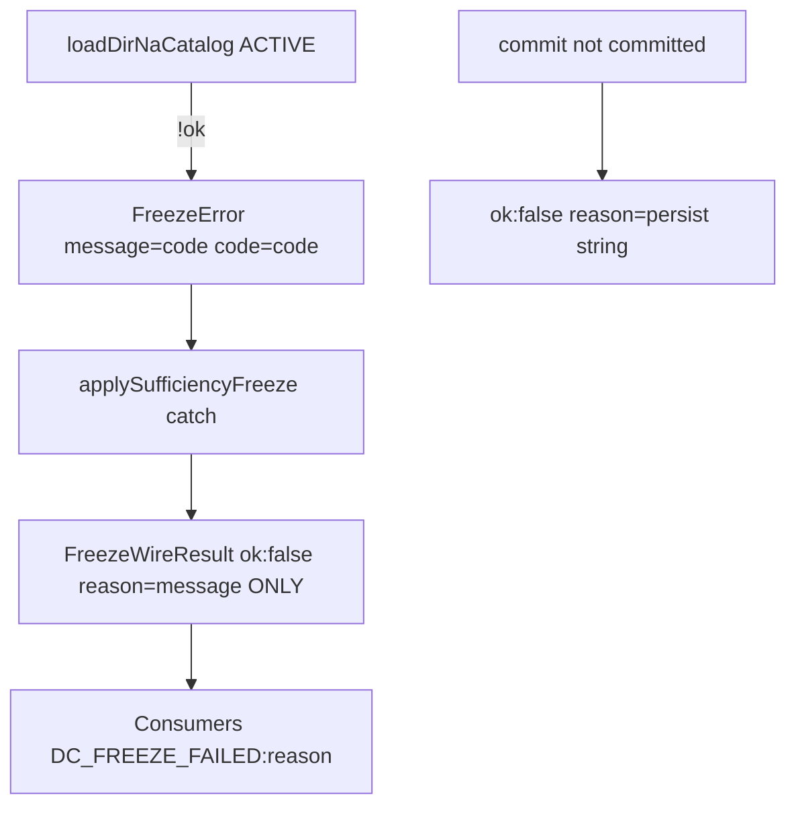
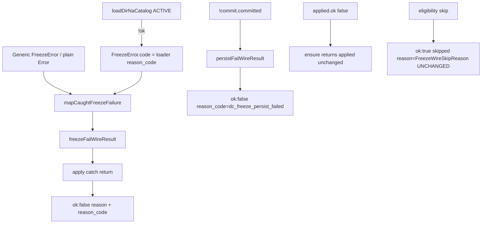

# STAGE-3.2 S3 Implementation Plan

**S3 Implementation Plan — Plan Only — Not Authorized for Implementation**

| Field | Value |
|---|---|
| **Document status** | PLAN ONLY — no production/test implementation authorized by this document |
| **Revision** | **1.2** (resolves evidence-classification findings R1–R4 against `dfcd9122`) |
| **Rev 1.1 plan commit** | `dfcd9122254dea500475527a7847afd6572c94c9` |
| **Rev 1.0 plan commit** | `ce520987e928cc7fc7ea10313db8666f90661828` |
| **Authoritative design** | [`STAGE-3.2-DIR-CATALOG-VERTICAL-SLICE-DESIGN.md`](./STAGE-3.2-DIR-CATALOG-VERTICAL-SLICE-DESIGN.md) **Revision 1.3** §5.2, §7 (DC-4/5/6 wire), §10.1, §10.3 **S3 row** |
| **S2 accepted baseline** | `9411c83f475605945874f87bb969db3ac1329ee9` |
| **S2 parent** | `7eda9bd44791562c0f4c151231df898fe6319c6a` |
| **Proposed implement branch** | `feat/s3-freeze-wire-reason-code` (from S2 tip above) |
| **S3 implement** | **NOT AUTHORIZED** until independent plan review PASS + separate written implement auth |

### Revision history — review resolutions

| Rev | Against | Resolutions |
|---|---|---|
| **1.1** | `ce520987` | Catch/persist helpers; consumer audit; Tier A/B/C introduced |
| **1.2** | `dfcd9122` | **R1** separate helper unit / actual catch execution / code-review; **R2** actual `ensure*` apply-propagation + persist-fail execution (or explicit untested); **R3** keep consumer audit + implement-time re-search + tsc; **R4** Tier B = only behavior actually executed on production functions |

---

## 1. Objective

Wire-level structured failure reporting for Freeze:

- Preserve S2 `FreezeError.code` (internal).
- Map allowlisted internal codes onto `FreezeWireResult` **`reason_code`** when `ok: false`.
- Keep skip paths and persistence failures distinguishable.
- Do **not** treat arbitrary `Error.message` as a public machine code.

S3 builds **only** on accepted S2. No Catalog/loader/S2 compose changes in this phase.

---

## 2. Production call-chain audit (inspected @ S2 tip)

### 2.1 End-to-end path (catalog load fail)

```
loadDirNaCatalog(ACTIVE)                         // catalog/load-dir-na-catalog.ts
  → !ok { reason_code }
buildFreezeNaValidationFromSession               // freeze-to-delivery.ts ~L152–154
  → throw new FreezeError(reason_code, { code: reason_code })   // S2 — .code set
freezeDraftForDelivery
  → buildFreezeNaValidationFromSession → freezeDecisionContext
applySufficiencyFreezeToSession                  // production-freeze-wire.ts ~L144–172
  → try { freezeDraftForDelivery(...) }
  → catch (e) {
        return { ok: false, reason: e.message, session }   // ★ STRUCTURE LOST
      }
ensureSessionFrozenForDelivery                   // ~L180–250
  → applySufficiencyFreezeToSession(...)
  → if !ok return applied                          // propagates string-only failure
  → else persist via commitDecisionContextChange
  → if !commit.committed → { ok:false, reason: commit.error ?? "dc_freeze_persist_failed" }
```

### 2.2 Where structured information is lost today

| Site | Behavior | Loss |
|---|---|---|
| `applySufficiencyFreezeToSession` catch L167–172 | `reason: e instanceof Error ? e.message : String(e)` | **`FreezeError.code` discarded**; only message kept |
| `FreezeWireResult` `ok: false` | `{ reason: string }` only | No `reason_code` field |
| Snapshot / bind failures in `assertSessionDraftBusinessSnapshotBound` | throw plain `Error` with prose message | Caught same catch → message becomes Wire `reason` |
| Generic `FreezeError` (CTA/stall/sufficiency/…) | usually **no** `.code` | Wire cannot classify vs catalog |
| `ensureSessionFrozenForDelivery` persist fail L239–243 | `reason: commit.error ?? "dc_freeze_persist_failed"` | No structured `reason_code`; luckily default string is already a token |

### 2.3 Complete `FreezeWireResult` consumer / type audit (R3 — preserved)

**Type definition (sole constructor site today):**  
`lib/poju/decision-context/production-freeze-wire.ts` — `FreezeWireResult` discriminated union; `ok: false` = `{ reason: string; session }` only.  
**Re-export:** `lib/poju/decision-context/index.ts` → `export * from "./production-freeze-wire"`.

**No other production file constructs `ok: false` FreezeWireResult literals.** Only the two functions below return that branch.

#### 2.3.1 Producers (must gain `reason_code`)

| Function | Fail branches | S3 change |
|---|---|---|
| `applySufficiencyFreezeToSession` | catch → `{ ok:false, reason, session }` | Via `freezeFailWireResult` |
| `ensureSessionFrozenForDelivery` | (a) return `applied` when `!applied.ok`; (b) persist `!commit.committed` | (a) pass-through; (b) via `persistFailWireResult` |

#### 2.3.2 Runtime / product consumers

| File | Call site | Fields read | Narrowing | Reads `reason` on fail? | Uses `reason_code` today? | S3 Diff required? |
|---|---|---|---|---|---|---|
| `lib/llm/pro/final-delivery.ts` ~L931–941 | `ensureSessionFrozenForDelivery` | `ok`, `reason`, `session` | `if (!freeze.ok)` | Yes — `DC_FREEZE_FAILED:${freeze.reason}` | No | **No** — keeps `.reason` |
| `lib/poju/phases/segment2/control.ts` ~L1452–1473 | `ensureSessionFrozenForDelivery` | `ok`, `reason`, `session` | `freeze.ok` then `!freeze.ok && draft` | Yes — same throw | No | **No** |
| `lib/llm/pro/delivery/lab/pipeline-jobs.ts` ~L1184–1215 | `applySufficiencyFreezeToSession` | `ok`, `skipped`, `pack`, `binding`, `reason`, `session` | `freeze.ok` / `else if draft` | Yes — same throw | No | **No** |

**HTTP / API:** None of the above serialize `FreezeWireResult` as JSON response. Failures become thrown `Error` with prefix `DC_FREEZE_FAILED:` + **`freeze.reason`**. No API DTO contract change in S3. **No consumer changes are authorized by this plan.**

#### 2.3.3 Scripts / harness consumers

| File | Call site | Fields read | S3 Diff required? |
|---|---|---|---|
| `scripts/s8-freeze-and-thesis.ts` ~L78–84 | `applySufficiencyFreezeToSession` | `ok`, `skipped`, `reason` (log only) | **No** |
| `scripts/test-s5-freeze-s6-observation.ts` ~L158–188 | `applySufficiencyFreezeToSession` | Asserts `ok: true` success / skip only | **No** |
| `scripts/test-intake-r6-freeze-versioning.ts` ~L659+, ~L997 | `ensureSessionFrozenForDelivery` / `applySufficiencyFreezeToSession` | Expects success or skip; `JSON.stringify(freeze)` on unexpected fail | **No** required; suite remains staged RED at F1 until S5 (disclose) |

#### 2.3.4 TypeScript compatibility verdict

| Concern | Verdict |
|---|---|
| Adding **required** `reason_code: string` on `ok: false` | Breaks **only** sites that construct that variant → both are inside `production-freeze-wire.ts` (S3 Diff). |
| Consumers that only read `.reason` after `!ok` | Compile + runtime OK. |
| Skip arm `reason: FreezeWireSkipReason` | Unrelated field; **must not** add `reason_code` on `ok: true`. |
| Exhaustive switches on skip `reason` | Unaffected. |
| Discriminated access `freeze.reason` when `ok` | TypeScript already requires narrowing; S3 must keep fail `reason`. |
| Barrel re-export | Helpers exported from same module; index star-export picks them up. |
| Downstream optional adoption of `reason_code` | **Out of S3 Diff**. |

#### 2.3.5 Implement-time re-audit (R3 — mandatory when implement authorized)

Before ACCEPT, implement must:

1. Re-run repository-wide search for `FreezeWireResult` construction sites and consumers (not rely solely on this plan’s inventory).
2. Confirm still **no** consumer Diff and **no** unauthorized construction sites outside `production-freeze-wire.ts`.
3. Run `pnpm exec tsc --noEmit` (Tier C).

**Skip path (`ok: true, skipped: true`)** uses `reason: FreezeWireSkipReason` — **unchanged by S3**.

### 2.4 S2 already provides (do not redo)

- `FreezeError` ctor with optional `{ code?: string }`.
- Catalog load fail throws `FreezeError(reason_code, { code: reason_code })`.
- ACTIVE load + ignore `authority.dirCatalog`.
- `!load.ok → FreezeError.code` remains **code-reviewed, not runtime-tested** (S2). S3 does **not** add Registry injection to runtime-test that branch.

---

## 3. Current vs proposed error flow

### 3.1 Current (S2)



### 3.2 Proposed (S3)



---

## 4. Design decisions (locked for this plan)

### 4.1 Internal `FreezeError.code` vs Wire `reason_code`

| Layer | Field | Role |
|---|---|---|
| Internal | `FreezeError.code?: string` | Set by throw sites (catalog already); **not** a public API contract by itself |
| Wire | `FreezeWireResult` `ok: false` → **`reason_code: string`** (required on fail branch) | Closed / allowlisted machine token for callers |
| Wire | `reason: string` | **Backward-compatible** human/legacy string (may equal `reason_code` for catalog; may remain prose for generic freeze) |

**Ownership:** Mapping + Wire fail assembly live **only** in `production-freeze-wire.ts`. Compose/S2 does not build `FreezeWireResult`.

### 4.2 Mapping boundary

```ts
// Pseudocode — plan only
function mapCaughtFreezeFailure(e: unknown): {
  reason: string;
  reason_code: string;
}

function freezeFailWireResult(
  session: POJUSessionState,
  e: unknown,
): Extract<FreezeWireResult, { ok: false }>

function persistFailWireResult(
  session: POJUSessionState,
  commitError?: string | null,
): Extract<FreezeWireResult, { ok: false }>
```

- Catch path: `return freezeFailWireResult(session, e)` only.
- Persist path: `return persistFailWireResult(session, commit.error)` — **does not** call `mapCaughtFreezeFailure`.

### 4.3 Allowlisted internal codes → Wire `reason_code` (1:1)

**Catalog / loader (map when `e instanceof FreezeError` && `e.code` in set):**

| Internal `FreezeError.code` | Wire `reason_code` | S3 claim |
|---|---|---|
| `dir_catalog_ssot_unavailable` | `dir_catalog_ssot_unavailable` | DC-4 wire mapping |
| `dir_catalog_load_failed` | `dir_catalog_load_failed` | DC-5 |
| `dir_catalog_version_unknown` | `dir_catalog_version_unknown` | DC-6 (distinct; loader-level — wire must still map if thrown) |
| `dir_catalog_version_missing` | `dir_catalog_version_missing` | DC-4-missing (loader-only; map if present; **not** claimed as everyday Freeze ACTIVE path) |
| `dir_catalog_version_invalid` | `dir_catalog_version_invalid` | Loader-only; map if present |

**Persist (not from FreezeError):**

| Source | Wire `reason_code` |
|---|---|
| `!commit.committed` | `dc_freeze_persist_failed` |
| Prefer stable token even if `commit.error` prose exists | `reason` may carry `commit.error` for debug; **`reason_code` stays `dc_freeze_persist_failed`** |

### 4.4 Unknown or absent internal code

| Case | `reason_code` | `reason` |
|---|---|---|
| `FreezeError` with **no** `.code` | `freeze_failed` | Keep `e.message` (compat for `DC_FREEZE_FAILED:${reason}`) |
| `FreezeError` with `.code` **not** in allowlist | `freeze_failed` | Keep message; **do not** pass unknown code through as public `reason_code` |
| Non-`FreezeError` `Error` (e.g. snapshot mismatch / missing `session_id`) | `freeze_failed` | Keep `e.message` |
| Non-Error throw | `freeze_failed` | `String(e)` |

**Forbidden:** `reason_code = e.message`; exposing arbitrary internal strings as codes.

### 4.5 Generic Freeze vs catalog vs persistence

| Class | How distinguished |
|---|---|
| Catalog loader | `reason_code` ∈ `dir_catalog_*` allowlist |
| Generic Freeze / bind / sufficiency | `reason_code === "freeze_failed"` |
| Persistence | `reason_code === "dc_freeze_persist_failed"` |
| Eligibility skip | Still `ok: true, skipped: true, reason: FreezeWireSkipReason` — **not** `ok: false` |

### 4.6 Persistence vs Freeze validation

`ensureSessionFrozenForDelivery`:

1. If `applySufficiencyFreezeToSession` returns `ok: false` → **return `applied` unchanged** (including `reason_code`).
2. If persist fails → **separate** branch: `persistFailWireResult` → `reason_code: "dc_freeze_persist_failed"`; never reuse catalog codes; never parse `commit.error` into `reason_code`.

### 4.7 Backward compatibility

| Consumer expectation | S3 rule |
|---|---|
| `freeze.ok` / `freeze.skipped` | Unchanged |
| `freeze.reason` on fail | **Remain present**; for catalog failures set `reason === reason_code` |
| `DC_FREEZE_FAILED:${freeze.reason}` | Continues to work |
| Skip `reason` union | Unchanged |
| New field | Add **`reason_code: string`** on `ok: false` only (required) |

**API response contracts:** No separate Freeze DTO in HTTP layer (§2.3). **Out of S3:** changing `DC_FREEZE_FAILED` prefix or consumer Diff.

### 4.8 Explicit non-assumptions

- Not every `Error.message` is a stable code.
- S3 does **not** claim runtime fault-injection of S2 `!load.ok` inside production loader.
- S3 does **not** claim wire `reason_code` ≡ “catalog load was runtime-faulted in CI.”
- Direct helper unit tests do **not** prove enclosing production catch/persist branches executed.

---

## 5. Exact files and functions to change

### 5.1 Production allowlist

| Path | Change |
|---|---|
| [`lib/poju/decision-context/production-freeze-wire.ts`](../../../lib/poju/decision-context/production-freeze-wire.ts) | Extend `FreezeWireResult` `ok: false` with `reason_code: string`; add **exported** `mapCaughtFreezeFailure`, `freezeFailWireResult`, `persistFailWireResult`; catch → `freezeFailWireResult`; persist fail → `persistFailWireResult` |

### 5.2 Production denylist (S3)

- `freeze.ts` / `freeze-to-delivery.ts` / `catalog/**` / `na-declaration.ts`
- Sufficiency Gate, Schema, C5, Versioning, CFP/Topic, S4/S5 work
- Consumer files in §2.3.2–2.3.3 — **no required change**
- Adding `writeCore` (or other) inject parameters to `ensureSessionFrozenForDelivery` solely for tests — **forbidden** (expands production surface)

### 5.3 Tests allowlist (when implement authorized)

| Path | Role |
|---|---|
| **Preferred:** new `scripts/test-intake-r6-freeze-wire-reason.ts` + `package.json` script | Tier A helpers + Tier B production-function execution; labeled PASS lines |
| May reuse fixtures/patterns from | `scripts/test-intake-r6-freeze-versioning.ts` (IDB reset, sufficient draft seed, CAS), `scripts/test-s5-freeze-s6-observation.ts` (skip/success) |

---

## 6. Test matrix and evidence tiers (R4 — Rev 1.2)

### 6.0 Evidence classification (locked)

Three **independent** evidence kinds. Do not conflate them.

| Kind | Label | Counts as proof of… | Does **not** count as… |
|---|---|---|---|
| **Helper unit** | `[Tier A]` | Mapper / `freezeFailWireResult` / `persistFailWireResult` behavior on constructed inputs | Execution of `applySufficiencyFreezeToSession` catch or `ensureSessionFrozenForDelivery` persist branch |
| **Production-function execution** | `[Tier B]` | Actual call of `applySufficiencyFreezeToSession` / `ensureSessionFrozenForDelivery` that enters the branch under test | Helper-only calls; static review |
| **Static code-review** | `[Code-review]` | Catch/persist bodies are thin `return *FailWireResult(...)`; ensure pass-through unchanged | Runtime execution of those branches |
| **Regression** | `[Tier C]` | Existing suites + tsc + consumer re-search | New Wire mapping correctness |

**Hard rule (R4):** Tier B PASS lines may be printed **only** when the named production function was invoked and the target branch ran. Helper unit tests stay `[Tier A]`. Code-review stays `[Code-review]` — **never** relabeled as Tier B.

Implement reports **must** use labels like:

- `PASS  [Tier A] mapCaughtFreezeFailure dir_catalog_load_failed`
- `PASS  [Tier A] freezeFailWireResult constructed FreezeError …` *(helper — not catch execution)*
- `PASS  [Tier B] applySufficiencyFreezeToSession catch → freeze_failed`
- `PASS  [Tier B] ensureSessionFrozenForDelivery apply-fail propagation`
- `PASS  [Tier B] ensureSessionFrozenForDelivery persist-fail → dc_freeze_persist_failed` **or** `UNTESTED  [production-path] ensure persist-fail …`
- `PASS  [Code-review] catch body === freezeFailWireResult only`
- `PASS  [Tier C] tsc --noEmit`

### 6.1 Tier A — Helper unit tests

#### 6.1.1 `mapCaughtFreezeFailure`

| Case | Input | Expected `reason_code` | Expected `reason` |
|---|---|---|---|
| Each allowlisted catalog code | `FreezeError(code, { code })` | same code | same code (or message===code) |
| Unknown code | `FreezeError("x", { code: "not_in_allowlist" })` | `freeze_failed` | message preserved |
| Missing code | `FreezeError("Decision not sufficient…")` | `freeze_failed` | message preserved |
| Plain `Error` | `new Error("freezeDraftForDelivery: …")` | `freeze_failed` | message preserved |
| Non-Error | `"boom"` | `freeze_failed` | `"boom"` |

#### 6.1.2 `freezeFailWireResult` / `persistFailWireResult` (helpers only)

| Case | Assert |
|---|---|
| Constructed catalog `FreezeError` → `freezeFailWireResult` | `ok:false`, `reason_code` 1:1, session identity |
| Constructed unknown/missing/plain/non-Error → `freezeFailWireResult` | `reason_code === "freeze_failed"` |
| `persistFailWireResult(session, "cas boom")` | `reason_code === "dc_freeze_persist_failed"`, `reason` carries error text |
| `persistFailWireResult(session, null)` | `reason_code` and `reason` === `"dc_freeze_persist_failed"` |
| Distinctness | persist `reason_code` ≠ any `dir_catalog_*` and ≠ accidental sole reliance on `freeze_failed` |

**Label:** `[Tier A]` — **forbidden** to claim these prove catch/persist production branches ran.

### 6.2 Code-review gates (not Tier B)

Required for ACCEPT; report as `[Code-review]`:

1. `applySufficiencyFreezeToSession` catch body is exactly `return freezeFailWireResult(session, e);` (no inline remapping).
2. `ensureSessionFrozenForDelivery` persist fail is exactly `return persistFailWireResult(session, commit.error);`.
3. On `!applied.ok`, ensure **returns `applied` unchanged** (no rebuild that drops `reason_code`).
4. Catalog-coded throws through `apply*` catch remain **runtime-untested** without Registry (S2 policy preserved); coverage for those codes is Tier A mapping + this review that catch uses the helper.

### 6.3 Tier B — Production-function execution (R1 / R2 corrected)

#### 6.3.1 R1 — Actual catch path of `applySufficiencyFreezeToSession`

**Rev 1.1 error:** Calling `freezeFailWireResult` directly was mislabeled as production catch-path evidence.

**Rev 1.2 locked:**

| Evidence | Method | Claim allowed? |
|---|---|---|
| Helper unit | `freezeFailWireResult(...)` | Tier A only |
| Code-review | catch → helper | `[Code-review]` only |
| **Required Tier B** | Invoke **`applySufficiencyFreezeToSession(session)`** such that `freezeDraftForDelivery` throws and the **catch branch returns** | Yes — this is catch-path execution |

**Preferred executable fixture (no Registry, no S2 change, no test-only production seams):**

- Build a **sufficient** draft (reuse freeze-versioning / s5 sufficient-draft patterns) so `canFreezeSessionOnSufficiency` returns `allowed: true`.
- Put it on a session whose `session_id` is missing/empty (or otherwise trip `assertSessionDraftBusinessSnapshotBound` / bind failure with a plain `Error` **without** mutating Catalog/loader).
- Call `applySufficiencyFreezeToSession(session)`.
- Assert: `ok === false`, `reason_code === "freeze_failed"`, `reason` preserves the thrown message, session returned is the input session.

**Why this hits the real catch:** Eligibility passes; `freezeDraftForDelivery` throws plain `Error` (e.g. `freezeDraftForDelivery: session.session_id required`); catch runs.

**Still untested (explicit):** Catalog-coded `FreezeError` (`dir_catalog_*`) entering that same catch via ACTIVE loader failure — **UNTESTED production-function-path** (no Registry). Covered by Tier A + Code-review only. Do not claim otherwise.

#### 6.3.2 R2 — `ensureSessionFrozenForDelivery` propagation and persist

##### (1) Apply-failure propagation — **required Tier B**

- Use the **same** catch-inducing session as §6.3.1 (sufficient draft, empty/`invalid` for bind so apply catch fires).
- Call **`ensureSessionFrozenForDelivery(session, { trigger: "pre_delivery_safety", … })`**.
- Assert: `ok === false`, `reason_code === "freeze_failed"` (same class as apply fail — **not** `dc_freeze_persist_failed`), proving ensure did not remap apply failure into persist codes.

##### (2)–(3) Persistence-failure branch — **Tier B if feasible; else explicit UNTESTED**

Target branch today:

```
if (!commit.committed) {
  return { ok: false, reason: commit.error ?? "dc_freeze_persist_failed", session };
}
```

After S3: `return persistFailWireResult(session, commit.error)`.

**Constraint:** `ensureSessionFrozenForDelivery` does **not** expose `writeCore` / CAS inject. Adding such a parameter for tests is **out of S3** (production-surface expansion).

**Feasibility order (implement must try in order; report which landed):**

| Attempt | Approach | Tier B if succeeds |
|---|---|---|
| A | Reuse existing IDB fixtures (`__resetPojuDbForTests`, `createPOJUSession`, seed sufficient draft as in freeze-versioning §C). After in-memory freeze would succeed, force **core write failure** via existing CAS/IDB behavior (e.g. delete/absent row so `savePOJUSessionCore` → CAS throws → `commit.committed === false`) **without** new production APIs | `ok:false`, **`reason_code === "dc_freeze_persist_failed"`**, `reason` may carry underlying error; ≠ `dir_catalog_*` / not remapped to sole `freeze_failed` |
| B | Any other **existing** test harness hook already used by freeze-versioning/CAS suites that can make `commitDecisionContextChange` return `!committed` while still calling **production** `ensureSessionFrozenForDelivery` unchanged | Same asserts |
| C | If A/B genuinely fail without expanding production surface | Report `UNTESTED  [production-path] ensureSessionFrozenForDelivery persist-fail branch` + rely on `[Tier A] persistFailWireResult` + `[Code-review] return persistFailWireResult(...)` |

**Hard rule:** `[Tier A] persistFailWireResult` alone **must not** be claimed as proof that the ensure persist branch executed.

##### (4) Skip and success — **required Tier B**

Reuse existing fixtures (freeze-versioning / s5 observation patterns):

| Case | Call | Assert |
|---|---|---|
| Success freeze (in-memory) | `applySufficiencyFreezeToSession` sufficient draft | `ok: true`, pack/session final; no `reason_code` on success arm |
| Skip already frozen / not sufficient / stall path | eligibility | `ok: true`, `skipped: true`, `reason ∈ FreezeWireSkipReason`; **no** `reason_code` |
| Success persist (optional if IDB available) | `ensureSessionFrozenForDelivery` on seeded session | `ok: true` (or disclose env limits); must not break existing green expectations |

### 6.4 Tier C — Compatibility / regression

| Suite | Expectation | Label |
|---|---|---|
| Repo-wide construction/consumer re-search (§2.3.5) | No surprise sites; no consumer Diff | `[Tier C]` |
| `pnpm test:intake-r6-dir-catalog` | PASS (S0–S2) | `[Tier C]` |
| `pnpm test:intake-r6-na-cas` / `resolver` | PASS | `[Tier C]` |
| New wire-reason script | Tier A + required Tier B + Code-review checklist | own labels |
| `pnpm exec tsc --noEmit` | PASS | `[Tier C]` |
| `pnpm test:intake-r6-freeze-versioning` | Known staged RED at F1 until S5 — **disclose** | `[Tier C disclose]` |

### 6.5 Explicitly out of / untested claims

| Claim | Status |
|---|---|
| Runtime ACTIVE catalog load fail → apply catch (`dir_catalog_*`) | **UNTESTED** production-function-path (no Registry) |
| S2 compose `!load.ok` runtime | Out (S2 policy) |
| Helper unit ≡ catch/persist branch execution | **Forbidden misclaim** |
| Code-review ≡ Tier B execution | **Forbidden misclaim** |
| S4 / S5 / consumer `DC_FREEZE_FAILED` → `reason_code` | Out |

---

## 7. Compatibility analysis (R3 detail)

| Area | Impact |
|---|---|
| TypeScript consumers of `FreezeWireResult` | Runtime product consumers (§2.3.2) only read `.reason` after `!ok` → **compatible without Diff**. |
| Construct sites | Only wire file → **must** set `reason_code` in S3 Diff. |
| Implement re-search + tsc | Mandatory before ACCEPT (§2.3.5). |
| `DC_FREEZE_FAILED:${freeze.reason}` | Compatible; catalog failures become token-shaped reasons when that path is hit. |
| Skip union | Unchanged; no `reason_code` on skip. |
| HTTP API | No FreezeWireResult DTO — **no API contract change**. |
| S2 compose | Unchanged. |
| Persist failure | Gains explicit `reason_code`; `reason` may still show commit error text. |

---

## 8. Non-goals and phase boundaries

| Non-goal | Owner |
|---|---|
| Catalog SSOT / loader / S2 ACTIVE isolation | Frozen |
| Sufficiency Gate / CTA / stall rules | Frozen |
| Schema / C5 / Versioning / CFP / Topic | Out |
| S4 DC-10 | Next |
| S5 F1–F4 fixture migration | Later mandatory |
| Consumer Diff / HTTP envelope change | Out |
| Equating S3 with “catalog load runtime-faulted in CI” | Forbidden |
| Production Registry / test-only loader injection / new ensure inject APIs | Forbidden |
| Claiming helper tests prove enclosing production branches | Forbidden |

---

## 9. Acceptance criteria

S3 may be accepted only when:

1. `FreezeWireResult` `ok: false` includes **`reason_code: string`**.
2. Catch path is `return freezeFailWireResult(session, e)` only (`[Code-review]`); allowlisted codes map 1:1 in **`[Tier A]`**; unknown/absent → `freeze_failed`; **never** message-as-code.
3. Persist fail site is `return persistFailWireResult(...)` (`[Code-review]`); helper asserts `dc_freeze_persist_failed` (`[Tier A]`).
4. **`[Tier B]`** executes:
   - `applySufficiencyFreezeToSession` **catch** → `freeze_failed` (plain bind/`session_id` fixture);
   - `ensureSessionFrozenForDelivery` **apply-fail propagation** → `freeze_failed` (not persist code);
   - skip + success paths unchanged;
   - **and either** `ensureSessionFrozenForDelivery` **persist-fail** → `dc_freeze_persist_failed` **or** explicit `UNTESTED [production-path]` for that branch (helper+review only — no false Tier B claim).
5. Evidence labels obey §6.0 (helper ≠ Tier B; code-review ≠ Tier B).
6. Production Diff ⊆ §5.1; baseline parent = `9411c83f475605945874f87bb969db3ac1329ee9`; S2 behavior preserved.
7. Consumer Diff empty; §2.3.5 re-search + tsc done.
8. **Not claimed:** S4/S5; Registry catalog catch execution; S2 `!load.ok` runtime; helper≡enclosing-branch.

---

## 10. Verification commands (when implement authorized)

```bash
pnpm test:intake-r6-dir-catalog          # Tier C
pnpm test:intake-r6-na-cas                # Tier C
pnpm test:intake-r6-resolver              # Tier C
pnpm test:intake-r6-freeze-wire-reason   # Tier A + Tier B + Code-review checklist
pnpm exec tsc --noEmit                   # Tier C (+ consumer/construction re-search)
pnpm test:intake-r6-freeze-versioning     # Tier C disclose RED / S5 dependency
```

---

## Stop Condition

This document is **plan-only** (Revision **1.2**).

No production or test implementation is authorized hereby.  
Do not start S4/S5.  
Wait for independent plan review and **explicit written S3 implementation authorization**.

**PLAN ONLY — NOT AUTHORIZED FOR IMPLEMENTATION**
